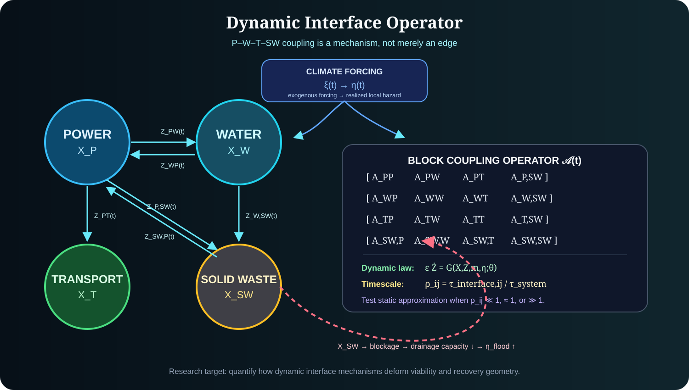
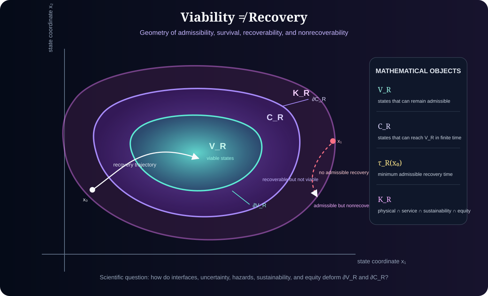
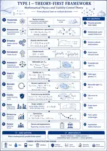
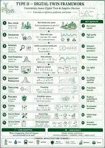
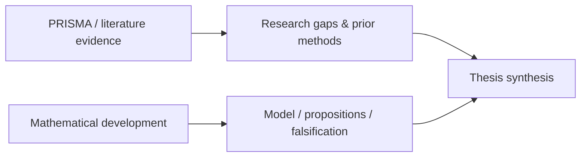

# Mathematical Physics of Sustainable Infrastructure Resilience

### Dynamic Interfaces, Sustainable–Equitable Viability, Recovery Geometry, and Climate Stress in Coupled P–W–T–SW Systems

> **Research proposition.** Sustainable infrastructure resilience is treated here as a constrained dynamical-systems problem: determine which states of a climate-stressed, dynamically coupled infrastructure system can remain within—or be returned to—a physically feasible, service-preserving, sustainable, and equitable operating region.

<p align="center">
  
</p>

> **Project-memory entry point:** [`PROJECT_MEMORY.md`](PROJECT_MEMORY.md) → corrected canonical v2 memory under [`project_memory/2026-08-21_chain_architecture_v2/`](project_memory/2026-08-21_chain_architecture_v2/).

---

## 1. Core thesis architecture and broader research program

The **core MSE architecture**, consistent with [`project/THESIS_SCOPE.md`](project/THESIS_SCOPE.md), is

$$
\boxed{
\mathcal D_{\mathrm{obs}}
\longrightarrow
(\widehat{\mathcal G},\widehat{\theta},\Sigma_\theta)
\longrightarrow
\mathcal F_{\mathrm{dyn}}
\longrightarrow
K_R
\longrightarrow
\mathcal V_R
\longrightarrow
\mathcal C_R
\longrightarrow
\mathcal U_{\mathrm{recovery}}
}
$$

The central mathematical contribution is concentrated on

$$
\boxed{
\text{Dynamic Coupling}
\rightarrow
\text{Admissibility}
\rightarrow
\text{Viability}
\rightarrow
\text{Recovery}
}
$$

with identification/inverse problems/UQ upstream and control/design as structured extensions.

The **broader long-term research program** can continue through

$$
\boxed{
\text{Observation}
\rightarrow
\text{Identification}
\rightarrow
\text{Dynamic Coupling}
\rightarrow
\text{Admissibility}
\rightarrow
\text{Viability}
\rightarrow
\text{Recoverability}
\rightarrow
\text{Control}
\rightarrow
\text{Design}
\rightarrow
\text{Optimization}
\rightarrow
\text{Decision}
}
$$

without implying equal original contribution at every stage in one MSE thesis.

The central geometric object is

$$
\boxed{\partial\mathcal V_R}
$$

—the boundary separating states for which admissibility can still be maintained from those for which it cannot under the declared model, disturbance set, uncertainty, and admissible controls.

### Three governing questions

$$
\boxed{
\begin{aligned}
Q_1 &: \text{What moves the viability boundary?}\\
Q_2 &: \text{How uncertain is that boundary?}\\
Q_3 &: \text{What interventions or designs move it in a favorable direction?}
\end{aligned}}
$$

The current central research question is:

> **How accurately must dynamic cross-infrastructure interfaces be identified and represented before sustainable/equitable viability and recovery predictions can be trusted?**

Full mathematical specification: [`project/MATHEMATICAL_FOUNDATION.md`](project/MATHEMATICAL_FOUNDATION.md)

---

## 2. Mathematical ontology

| Symbol | Mathematical role | Physical meaning |
|---|---|---|
| $X(t)$ | coupled state vector | state of Power–Water/Drainage–Transportation–Solid-Waste infrastructure |
| $Z(t)$ | interface state | evolving cross-sector coupling mechanisms |
| $m(t)$ | discrete mode | operating/failure configuration |
| $u(t)$ | control | recovery/intervention action |
| $\xi(t)$ | exogenous forcing | climate forcing |
| $\eta(t)$ | realized hazard | local flood/stress acting on infrastructure |
| $\theta$ | uncertain parameters | capacities, coupling strengths, thresholds, model parameters |
| $Y(t)$ | observation vector | partial/noisy measurements |
| $K_R$ | admissible set | physical + service + sustainability + equity constraints |
| $\mathcal V_R$ | viability kernel | states from which admissibility can be maintained |
| $\mathcal C_R$ | capture/recovery set | states from which $\mathcal V_R$ can be reached in finite time |
| $\tau_R$ | recovery-time map | minimum admissible recovery time |
| $d$ | design vector | topology, redundancy, capacities, storage, interface hardening |

---

## 3. Governing hybrid multiscale model

A general reduced representation is

$$
\boxed{
\begin{aligned}
\dot X &= F(X,Z,m,u,\eta;\theta),\\
\varepsilon\dot Z &= G(X,Z,m,\eta;\theta),\\
m^+ &= \Phi(X,Z,m,\eta),\\
Y &= H(X,Z;\theta)+\varepsilon_Y.
\end{aligned}}
$$

This deliberately separates:

1. **continuous sector dynamics**;
2. **dynamic interface evolution**;
3. **hybrid operating/failure modes**;
4. **partial observation and identification uncertainty**.

The numerical code currently committed under `methods/architecture/` is a **reference/synthetic QA layer**, not a claim that the full thesis model has already been calibrated or solved.

---

## 4. P–W–T–SW coupled system

The coupled state is

$$
X(t)=
\begin{bmatrix}
X_P(t)\\
X_W(t)\\
X_T(t)\\
X_{SW}(t)
\end{bmatrix}.
$$

A time-dependent coupling operator can be written as

$$
\mathcal A(t)=
\begin{bmatrix}
A_{PP} & A_{PW} & A_{PT} & A_{P,SW}\\
A_{WP} & A_{WW} & A_{WT} & A_{W,SW}\\
A_{TP} & A_{TW} & A_{TT} & A_{T,SW}\\
A_{SW,P} & A_{SW,W} & A_{SW,T} & A_{SW,SW}
\end{bmatrix}.
$$

The off-diagonal terms represent specified **interface mechanisms/interdependencies**, not merely graph adjacency.

<p align="center">
  
</p>

---

## 5. Climate forcing and waste–drainage–transport feedbacks

External forcing and realized hazard are separated:

$$
\boxed{\xi(t)\longrightarrow\eta(t)}.
$$

For the primary urban-flood demonstrator:

$$
\xi_{\mathrm{rainfall}}
\rightarrow
\eta_{\mathrm{flood}}.
$$

A candidate endogenous feedback is

$$
\boxed{
X_{SW}
\rightarrow
B_{\mathrm{drain}}
\rightarrow
\eta_{\mathrm{flood}}
\rightarrow
(X_P,X_W,X_T,X_{SW}).
}
$$

Transportation accessibility may affect waste-removal capacity and restoration logistics, closing additional feedback loops. The authoritative scope therefore describes the demonstrator as **urban flooding with waste–drainage–transport feedbacks**. These arrows are mechanisms to be specified and tested; the diagram alone is not evidence of causal magnitude.

---

## 6. Sustainability and equity as mathematical admissibility

The admissible region is defined by intersection:

```math
\boxed{
K_R
=
K_{\mathrm{phys}}
\cap
K_{\mathrm{service}}
\cap
K_{\mathrm{sus}}
\cap
K_{\mathrm{eq}}.
}
```

Therefore a technically functioning trajectory is not automatically acceptable:

$$
\boxed{
\text{operational recovery}
\not\Rightarrow
\text{sustainable-equitable recovery}.
}
$$

The sustainability and equity terms must ultimately be operationalized as explicit measurable constraints before final inference.

---

## 7. Viability geometry

For admissible controls $u(\cdot)\in\mathcal U$,

```math
\boxed{
\mathcal V_R
=
\left\{
x_0\in K_R:
\exists u(\cdot)\in\mathcal U
\text{ such that }
X(t;x_0,u,\eta,\theta)\in K_R
\;\forall t\ge0
\right\}.
}
```

The research problem is therefore not merely to compute a resilience score, but to determine and explain the geometry of $\mathcal V_R$ and especially $\partial\mathcal V_R$.

A later finite-horizon, time-varying-admissibility, stochastic or nonanticipative formulation must be documented as an explicit mathematical amendment rather than silently substituted for this current definition.

---

## 8. Recovery / capture geometry

Viability and recovery are distinct:

```math
\boxed{
\mathcal C_R
=
\left\{
x_0:
\exists u(\cdot),\exists T<\infty
\text{ such that }
X(T;x_0,u)\in\mathcal V_R
\right\}.
}
```

and

```math
\boxed{
\tau_R(x_0)
=
\inf\left\{
T:
\exists u(\cdot),
X(T;x_0,u)\in\mathcal V_R
\right\}.
}
```

This produces three scientifically different state classes:

$$
\boxed{
\text{viable}
\;|\;
\text{recoverable but nonviable}
\;|\;
\text{nonrecoverable}.
}
$$

<p align="center">
  
</p>

---

## 9. Dynamic-interface proposition

A core comparison is

$$
\mathcal V_{\mathrm{static}}=\mathcal V(\bar Z)
$$

versus

$$
\mathcal V_{\mathrm{dynamic}}=\mathcal V(Z(t)).
$$

Boundary deformation can be quantified by a declared set-distance metric, for example

```math
\boxed{
\Delta_{\mathcal V}
=
d_H\left(
\mathcal V_{\mathrm{dynamic}},
\mathcal V_{\mathrm{static}}
\right).
}
```

The nondimensional timescale ratio

```math
\boxed{
\rho_{ij}
=
\frac{\tau_{\mathrm{interface},ij}}
{\tau_{\mathrm{system}}}
}
```

motivates explicit tests of fast, commensurate, and slow interface regimes.

---

## 10. Inverse problems and uncertainty quantification

The architecture does not require hidden couplings to be known a priori. The upstream problem is

$$
\boxed{
\mathcal D_{\mathrm{obs}}
\longrightarrow
p(\mathcal G,\theta,Z\mid\mathcal D_{\mathrm{obs}}).
}
$$

A central reliability diagnostic is the change in inferred viability produced by parameter/interface estimation error:

```math
\boxed{
E_{\mathrm{inv}}
=
d_H\left[
\mathcal V(\theta^\star),
\mathcal V(\widehat\theta)
\right].
}
```

When uncertainty is represented probabilistically, a natural extension is

$$
P(x\in\mathcal V_R\mid\mathcal D_{\mathrm{obs}}).
$$

---

## 11. Control, design, and optimization

A viability-preserving control set may be represented as

```math
\mathcal U_V(x)
=
\left\{u:F(x,u,\eta)\in T_{K_R}(x)
\right\}
```

where the tangent-cone representation is used only where its assumptions are satisfied.

Design variables are collected in

$$
d=\{\text{capacity, topology, redundancy, storage, interface hardening}\}.
$$

Then

$$
\boxed{
d\longrightarrow\mathcal V_R(d),\qquad d\longrightarrow\mathcal C_R(d).
}
$$

A downstream resilience-constrained design problem can be expressed as

$$
\min_d J(d)
$$

subject to declared physical, service, sustainability, equity, recovery, and budget constraints.

These are **structured extensions** of the MSE core rather than an assertion that every downstream layer must contain an independent original contribution.

---

## 12. Three end-to-end thesis architectures

The same P–W–T–SW problem can be traversed through three distinct research philosophies.

### Type I — Theory-First

$$
\boxed{
(\theta,\eta)
\rightarrow
X(t)
\rightarrow
\mathcal V_R
\rightarrow
\mathcal C_R
\rightarrow
u
}
$$

**Core question:** What is mathematically possible?



### Type II — Digital Twin / Inference-to-Decision

$$
\boxed{
\mathcal D
\rightarrow
p(X,\theta,Z\mid\mathcal D)
\rightarrow
p(\mathcal V_R\mid\mathcal D)
\rightarrow
u_t
}
$$

**Core question:** What is happening, what will happen, and what should we do now?

The term **digital twin** should be used operationally only when an actual observation-update/calibration/validation loop is implemented.



### Type III — Resilience-by-Design

$$
\boxed{
d
\rightarrow
F_d
\rightarrow
\mathcal V_R(d)
\rightarrow
\mathcal C_R(d)
\rightarrow
d^\star
}
$$

**Core question:** What should we build so that acceptable behavior remains possible?


Framework archive and image hashes: [`assets/frameworks/README.md`](assets/frameworks/README.md)

Current MSE recommendation: **Type-I-centered core + Type-II upstream identification/UQ + limited Type-III downstream demonstration if feasible.**

---

## 13. Falsifiable scientific propositions

The current formal proposition registry is **P1–P7**. Historical H1–H7/T1 literature-ranking labels are preserved separately and should not be silently relabeled.

| ID | Proposition | Primary test |
|---|---|---|
| **P1** | Dynamic interfaces materially alter resilience geometry relative to static coupling. | Compare dynamic/static viability boundaries and $\Delta_{\mathcal V}$. |
| **P2** | Interface identifiability affects reliability of inferred viability. | Propagate parameter/interface uncertainty into viability uncertainty. |
| **P3** | Interface/system timescale ratios govern static-approximation validity. | Sweep $\rho_{ij}$ and evaluate state/boundary error. |
| **P4** | Sustainability/equity constraints deform the viable region beyond technical constraints. | Compare $\mathcal V(K_{tech})$ and $\mathcal V(K_{sus,eq})$. |
| **P5** | Recovery geometry contains information not captured by viability alone. | Compute $\mathcal C_R\setminus\mathcal V_R$ and $\tau_R$. |
| **P6** | Waste–drainage–flood feedback shifts coupled P–W–T–SW resilience boundaries. | Compare otherwise identical models with feedback on/off. |
| **P7** | Reduced models used for decisions must preserve or conservatively bound viability conclusions. | Compare $\mathcal V_r$ with projected full-order viability geometry. |

Detailed protocol: [`project/SCIENTIFIC_PROPOSITIONS.md`](project/SCIENTIFIC_PROPOSITIONS.md)  
Machine-readable registry: [`config/scientific_propositions.yaml`](config/scientific_propositions.yaml)  
Historical-label crosswalk: [`project_memory/2026-08-21_chain_architecture_v2/03_HYPOTHESIS_PROPOSITION_CROSSWALK.md`](project_memory/2026-08-21_chain_architecture_v2/03_HYPOTHESIS_PROPOSITION_CROSSWALK.md)

---

## 14. Primary physical demonstrator

**System:** coupled Power–Water/Drainage–Transportation–Solid-Waste infrastructure.  
**Hazard/demonstrator:** **urban flooding with waste–drainage–transport feedbacks**.

The demonstrator is intended to test the mathematical architecture through a physically interpretable coupled system, not to imply that every possible P–W–T–SW interaction is represented.

---

## 15. Evidence architecture

The project maintains two distinct evidence tracks:



**Evidence rule:** PRISMA provides transparent identification/screening/accounting. Monte Carlo ranks papers **within a declared eligible corpus**. Neither method proves global novelty.

---

## 16. Computational implementation

Different languages/formats are used only where they contribute a specific function:

| Tool | Role |
|---|---|
| **Markdown + LaTeX** | mathematical specification and derivation |
| **Mermaid** | inspectable architecture diagrams |
| **SVG** | version-controlled mathematical art / state-space geometry |
| **Python** | numerical QA, finite-grid viability baselines, geometry metrics, tests, memory audit |
| **Julia** | compact multiscale coupled-dynamics scaffold |
| **YAML** | machine-readable proposition registry |
| **JSON / JSON Schema** | project-memory and model-configuration contracts |
| **GitHub Actions** | automated scientific-architecture and memory-consistency QA |

Implementation entry point: [`methods/architecture/README.md`](methods/architecture/README.md)

### Current executable architecture files

- [`methods/architecture/viability_geometry.py`](methods/architecture/viability_geometry.py)
- [`methods/architecture/CoupledInfrastructure.jl`](methods/architecture/CoupledInfrastructure.jl)
- [`schemas/thesis_model.schema.json`](schemas/thesis_model.schema.json)
- [`tests/test_viability_geometry.py`](tests/test_viability_geometry.py)
- [`.github/workflows/scientific-architecture-qa.yml`](.github/workflows/scientific-architecture-qa.yml)
- [`.github/workflows/project-memory-qa.yml`](.github/workflows/project-memory-qa.yml)

The committed numerical examples are **synthetic reference implementations**. They verify geometry logic and software plumbing before a final calibrated thesis model is frozen.

---

## 17. Current literature-ranking status

The frozen logical closed-corpus protocol is hard-locked to:

`Thesis_Final_Unique_Papers_325_2026-08-20(1).csv`

SHA-256:

`047e80b7348190a9da8100758c5f1201cd39059f9318e6298dcda614ecb7813f`

The high-rigor archived run used a byte-identical uploaded copy named `Thesis_Final_Unique_Papers_325_2026-08-20(4).csv` with the same hash.

The protocol forbids historical rank/selection variables from entering the scientific score and interprets Top-K results only **within the locked dataset**.

A later three-model comparison found that the top ordering is model-sensitive enough that the two leading papers should be treated as **co-dominant primary precedents**, not as evidence of one universally dominant global paper. See [`project_memory/2026-08-21_chain_architecture_v2/06_MONTE_CARLO_AND_PRISMA_STATE.md`](project_memory/2026-08-21_chain_architecture_v2/06_MONTE_CARLO_AND_PRISMA_STATE.md).

The global PRISMA systematic-search layer remains methodologically separate from this closed-corpus ranking layer.

---

## 18. Repository structure

```text
MSE-thesis/
├── README.md
├── PROJECT_MEMORY.md
├── assets/
│   ├── frameworks/                 # Type I / II / III generated framework images
│   └── math-art/                   # repository-native SVG mathematical figures
├── config/                         # machine-readable research configuration
├── schemas/                        # formal model schemas
├── project/                        # scope, mathematical foundation, propositions
├── project_memory/                 # versioned future-chat scientific memory
├── methods/
│   ├── architecture/               # Python / Julia architecture implementation
│   └── monte_carlo/                # corpus-ranking code/index/results material
├── tests/                          # numerical architecture smoke tests
├── prompts/                        # exact available execution prompts
├── conversation/                   # user-visible research-development provenance
├── provenance/                     # hashes, inventories, archive status
├── archive/                        # session snapshots
└── .github/workflows/              # automated reproducibility/QA
```

**Raw datasets and large binary packages are not assumed to live under a root `data/` directory.** Their current storage/identity must be verified through the actual GitHub tree and `provenance/ONLINE_ARCHIVE.md` / `provenance/INVENTORY.csv` before describing them as GitHub-committed.

---

## 19. Reproducibility, conversation memory, and provenance

Historical user-visible material is preserved under `conversation/`, including the 2026-08-20 current-thread archive and the 2026-08-21 chain/framework segment.

The corrected future-chat memory entry point is:

`project_memory/2026-08-21_chain_architecture_v2/`

The repository distinguishes:

- exact/verbatim user requests where available;
- user-supplied reference text;
- reconstructed assistant-response indexes where exact wording is unavailable;
- exact prompts/code when preserved;
- corpus-derived results;
- synthetic QA;
- empirical/validated results;
- cryptographic hashes for frozen datasets and archived artifacts.

Hidden chain-of-thought, system/developer instructions, credentials, secrets, and connector internals are not part of the user-visible transcript archive.

Large byte-preserving artifacts that are stored externally are registered through `provenance/ONLINE_ARCHIVE.md`, `provenance/INVENTORY.csv`, and hash records rather than being falsely represented as native GitHub files.

---

## 20. Scientific scope and privacy

This is a private research-development repository. Mathematical equations, hypotheses, synthetic code, literature-ranking outputs, and architecture diagrams are research artifacts under active falsification and refinement.

The repository distinguishes clearly among:

- **formal definitions**;
- **testable propositions**;
- **mathematical templates**;
- **synthetic demonstrations**;
- **empirical evidence**;
- **literature-derived evidence**;
- **validated results**;
- **pending claims**.

No synthetic illustration or ranking result should be interpreted as empirical proof beyond its declared scope.