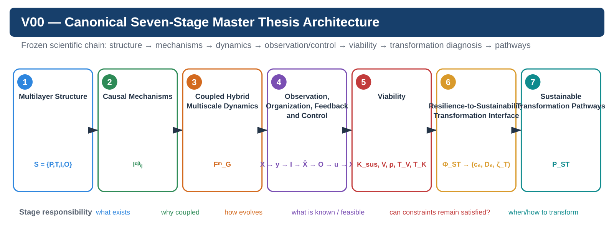
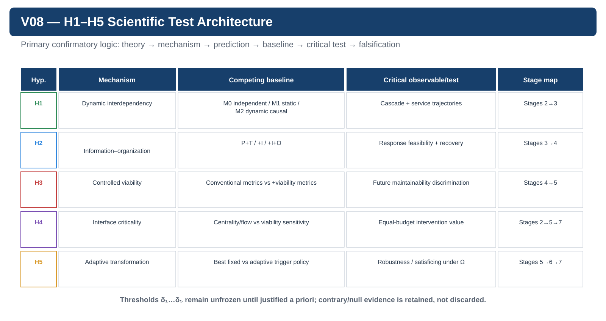
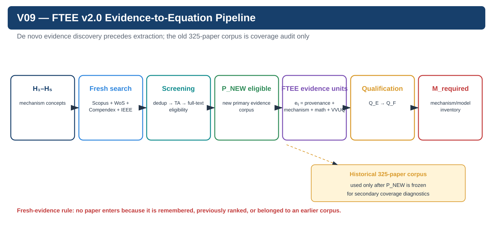
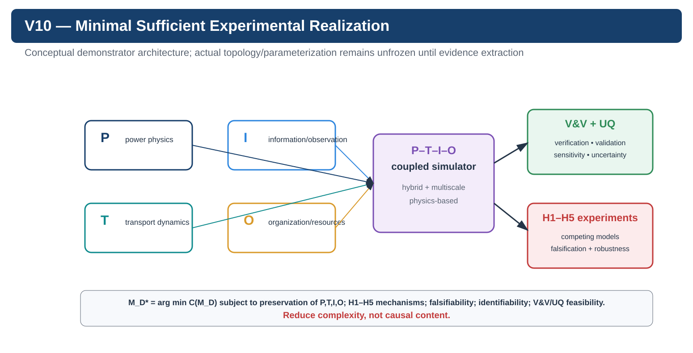

# MSE Thesis — Multilayer Interdependent Power–Transportation Infrastructure Resilience


**Degree:** Master of Science in Engineering (MSE), Sustainable Engineering  
**Repository:** active thesis source of truth  
**Framework status:** complete seven-stage conceptual and mathematical framework frozen  
**Hypothesis status:** five-primary-hypothesis logic frozen; numerical thresholds/test specifications not yet frozen  
**Evidence methodology:** FTEE v2.0 — fresh search from first principles followed by screening and full-text evidence-to-equation extraction  
**Old 325-paper corpus:** secondary coverage audit only  
**Citation standard:** APA 7th edition author–date  
**Updated:** 2026-09-11

> **Repository rule:** active thesis development belongs in `Dossiya-SE/MSE-thesis`. Historical/archive material is provenance only and cannot override current canonical files.

---

## Abstract

**Status:** Proposal / pre-results abstract.

The increasing electrification and interdependence of urban infrastructure are creating tightly coupled power–transportation systems whose resilience depends not only on physical network structure, but also on dynamic interdependencies, information availability, organizational response, and feasible control actions. However, existing resilience studies commonly treat these dimensions separately, rely on static dependency representations, or evaluate recovery primarily through service-loss metrics, providing limited insight into whether a disrupted system remains controllably capable of satisfying critical service and sustainability constraints. To address this gap, this study develops a **multilayer dynamics and controlled-viability framework for interdependent power–transportation systems**, explicitly integrating physical, informational, and organizational mechanisms. First, a multilayer interdependency representation is formulated to map state-, time-, and mode-dependent power–transportation interactions into coupled hybrid multiscale dynamics, enabling explicit characterization of disruption propagation and cascading effects. Second, an observation–organization–control layer is introduced to represent sensing, estimation, communication, coordination, resource availability, and response delays, thereby linking system state information to feasible intervention sets. Third, controlled viability theory is used to characterize the set of states from which sustainability and service constraints can remain satisfied under admissible controls, together with viability margins, time-to-viability loss, and interface-level criticality measures. Finally, adaptive transformation pathways are formulated as viability-constrained, many-objective transitions between alternative infrastructure architectures under deep uncertainty. The framework will be evaluated through a minimal sufficient power–transportation–information–organization demonstrator using physics-based simulation, verification and validation, uncertainty quantification, competing-model comparisons, and hypothesis-driven experiments. The study aims to establish when dynamic interdependencies, information and organizational constraints, viability-based indicators, and adaptive infrastructure transformation materially improve the characterization and management of infrastructure resilience.

> **Results rule:** quantitative performance claims are intentionally omitted at this stage. Numerical improvements will be added only after the confirmatory hypotheses $H_1$–$H_5$ have been tested.

---

<!-- CANONICAL_VISUAL:V00 -->

### V00 — Canonical Seven-Stage Master Thesis Architecture

<p align="center">
  
</p>

> **Visual synopsis:** This figure compresses the scientific architecture for navigation and interpretation. The equations, definitions, evidence status, and boundary rules in the owning document remain authoritative.

<!-- /CANONICAL_VISUAL:V00 -->

## Canonical entry points

| File | Role |
|---|---|
| [`project/README.md`](project/README.md) | active mathematical/project dashboard |
| [`project/THESIS_SCOPE.md`](project/THESIS_SCOPE.md) | frozen thesis scope |
| [`project/CANONICAL_7_STAGE_FRAMEWORK.md`](project/CANONICAL_7_STAGE_FRAMEWORK.md) | frozen seven-stage framework |
| [`project/RESEARCH_HYPOTHESES.md`](project/RESEARCH_HYPOTHESES.md) | five primary confirmatory hypotheses |
| [`project/ENGINEERING_CONFIRMATORY_HYPOTHESIS_MATRIX.md`](project/ENGINEERING_CONFIRMATORY_HYPOTHESIS_MATRIX.md) | confirmatory operationalization and VVUQ gates |
| [`project/MINIMAL_SUFFICIENT_EXPERIMENTAL_REALIZATION.md`](project/MINIMAL_SUFFICIENT_EXPERIMENTAL_REALIZATION.md) | demonstrator-reduction methodology |
| [`project/FRESH_SEARCH_FULL_TEXT_EVIDENCE_TO_EQUATION_PROTOCOL_FTEE_V2.md`](project/FRESH_SEARCH_FULL_TEXT_EVIDENCE_TO_EQUATION_PROTOCOL_FTEE_V2.md) | **current de novo evidence-search + FTEE methodology** |
| [`project/FRESH_HYPOTHESIS_EVIDENCE_SEARCH_PROTOCOL.md`](project/FRESH_HYPOTHESIS_EVIDENCE_SEARCH_PROTOCOL.md) | focused search-governance companion |
| [`project/CLOSED_CORPUS_EVIDENCE_SELECTION_PIPELINE.md`](project/CLOSED_CORPUS_EVIDENCE_SELECTION_PIPELINE.md) | old 325-paper coverage-audit methodology only |
| [`project/FULL_TEXT_EVIDENCE_TO_EQUATION_EXTRACTION_PROTOCOL_FTEE_V1.md`](project/FULL_TEXT_EVIDENCE_TO_EQUATION_EXTRACTION_PROTOCOL_FTEE_V1.md) | superseded FTEE v1.0 provenance pointer |
| [`project/MATHEMATICAL_PRESENTATION_V3.md`](project/MATHEMATICAL_PRESENTATION_V3.md) | GitHub math/rendering standard |
| [`tools/thesis_display_lint.py`](tools/thesis_display_lint.py) | automated Markdown/math/ontology QA |

---

## Frozen scientific framework

```math
\begin{aligned}
\underbrace{\mathcal S}_{1}
&\rightarrow
\underbrace{\mathfrak I}_{2}
\rightarrow
\underbrace{F_{\mathcal G}^{m}}_{3}\\
&\rightarrow
\underbrace{X\rightarrow y\rightarrow I\rightarrow\widehat X\rightarrow O\rightarrow u}_{4}\\
&\rightarrow
\underbrace{K_{\mathrm{sus}},\mathcal V,\rho,T_{\mathcal V},T_K}_{5}\\
&\rightarrow
\underbrace{\Phi_{\mathrm{ST}}\rightarrow(c_6,\mathcal D_6,\boldsymbol\zeta_T)}_{6}\\
&\rightarrow
\underbrace{\mathfrak P_{\mathrm{ST}}}_{7}.
\end{aligned}
```

The primary confirmatory set is

```math
\mathbb H=\{H_1,H_2,H_3,H_4,H_5\}.
```

The seven-stage architecture and H1–H5 scientific logic are frozen. Exact thresholds $\delta_i$, hypothesis domains $\Omega_H$, validation domains $\Omega_V$, and final confirmatory procedures remain to be specified *a priori* from the fresh evidence base and selected demonstrator.

---

<!-- CANONICAL_VISUAL:V08 -->

### V08 — H1–H5 Scientific Test Architecture

<p align="center">
  
</p>

> **Visual synopsis:** This figure compresses the scientific architecture for navigation and interpretation. The equations, definitions, evidence status, and boundary rules in the owning document remain authoritative.

<!-- /CANONICAL_VISUAL:V08 -->

## Current evidence methodology — FTEE v2.0

The active evidence pipeline is

```math
\begin{aligned}
H_i
&\rightarrow \text{mechanism concepts}
\rightarrow \text{fresh database search}
\rightarrow \text{screening}\\
&\rightarrow P_i
\rightarrow e_{ij}
\rightarrow M_{ij}
\rightarrow F_{ij}\\
&\rightarrow (X,\theta,A,\Omega)
\rightarrow (V,U)
\rightarrow \mathfrak M_{\rm required}\\
&\rightarrow \text{candidate demonstrators}
\rightarrow \text{V\&V/UQ/identifiability gates}
\rightarrow \mathcal M_D^\star.
\end{aligned}
```

The evidence corpus is an **output of the new research protocol**, not an inherited input.

Previously known and unknown papers are treated identically:

```math
P_{\rm known}\equiv P_{\rm unknown}.
```

The fresh eligible corpus is

```math
\mathcal P_{\rm eligible}^{\rm NEW}.
```

Only this newly qualified set enters full-text FTEE extraction.

---

## Search design

Separate hypothesis-specific search families are used:

```math
\mathcal S=\{S_{H_1},S_{H_2},S_{H_3},S_{H_4},S_{H_5}\}.
```

Core engineering databases are Scopus, Web of Science, Compendex and IEEE Xplore, supplemented where scientifically useful. The default search interval is database inception to final search date unless a narrower range is justified beforehand.

The discovery universe is

```math
\mathcal P_{\rm discovered}
=
\mathcal P_{\rm database}
\cup
\mathcal P_{\rm backward}
\cup
\mathcal P_{\rm forward}.
```

Database search is primary; citation chasing starts only from newly eligible anchors after the initial database search.

---

<!-- CANONICAL_VISUAL:V09 -->

### V09 — FTEE v2.0 Evidence-to-Equation Pipeline

<p align="center">
  
</p>

> **Visual synopsis:** This figure compresses the scientific architecture for navigation and interpretation. The equations, definitions, evidence status, and boundary rules in the owning document remain authoritative.

<!-- /CANONICAL_VISUAL:V09 -->

## FTEE extraction discipline

The evidence unit is

```math
e_{ij}
=
(S_i,L_{ij},C_{ij},M_{ij},F_{ij},X_{ij},\theta_{ij},A_{ij},\Omega_{ij},V_{ij},U_{ij},H_{ij}).
```

FTEE v2.0 requires exact provenance, source notation before thesis mapping, mechanism-first extraction, separate mechanism/form/validation evidence, dimensional and parameter audits, explicit assumptions, VVUQ separation, validation-domain tracking, uncertainty extraction, contrary/rival evidence, explicit missingness, and no silent model completion.

It **extracts and qualifies evidence; it does not choose the demonstrator**.

---

## Role of the old 325-paper corpus

The historical corpus is used only after the fresh corpus is frozen:

```math
\mathcal P_{\rm NEW}\leftrightarrow\mathcal P_{325}.
```

Its purpose is coverage diagnostics. A previously important old-only paper triggers a search-method diagnostic. It is never automatically inserted into the fresh evidence set.

---

## Governing evidence rules

```math
\textbf{No paper is evidence because we remember it.}
```

```math
\textbf{No paper is evidence because it belonged to an earlier frozen corpus.}
```

```math
\textbf{A paper becomes evidence only because the new reproducible search finds it and the new eligibility protocol qualifies it.}
```

---

<!-- CANONICAL_VISUAL:V10 -->

### V10 — Minimal Sufficient Experimental Realization

<p align="center">
  
</p>

> **Visual synopsis:** This figure compresses the scientific architecture for navigation and interpretation. The equations, definitions, evidence status, and boundary rules in the owning document remain authoritative.

<!-- /CANONICAL_VISUAL:V10 -->

## Immediate next task

Execute the **frozen $H_1$ CORE v1 search protocol** in Scopus, Web of Science Core Collection, Compendex and IEEE Xplore; preserve the four raw exports and search records; then construct $\mathcal P_{H_1}^{raw}$ for identity-preserving deduplication and title/abstract screening.
