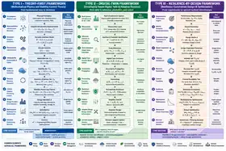
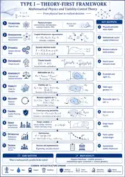
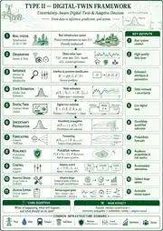
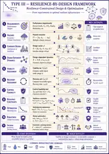

# Generated Thesis Framework Images

This folder contains the generated visual frameworks for the three end-to-end thesis architectures discussed on 2026-08-20.

## GitHub-renderable copies

### Combined comparison — Type I / Type II / Type III

- File: `framework_comparison_all_types.webp`
- SHA-256: `bf5bc480c5895c58e881feb36e350c98b8fc0396798acd2b0b522d01c0d7a6de`

### Type I — Theory-First Framework

- File: `type_i_theory_first_framework.webp`
- SHA-256: `37f30cb7ae1990fbd068120dc487bb6b7e7f8990594d2df577c3c35ae8b205e2`
- Scientific role: mathematical physics → coupled representation → dynamics → admissibility → viability → recovery → control → design → optimization → decision.

### Type II — Digital-Twin Framework

- File: `type_ii_digital_twin_framework.webp`
- SHA-256: `b5b705d8fa2957b994edb9fa07f4a4e731d7ac375af1d4ea0f81ff12fb6d23b7`
- Scientific role: real system → observation → inverse identification → state estimation → digital twin → uncertainty propagation → forecasting → probabilistic resilience → adaptive control → adaptive design → decision support.

### Type III — Resilience-by-Design Framework

- File: `type_iii_resilience_by_design_framework.webp`
- SHA-256: `792d620fae5eb545fe5e15e3fe194221ec367deb3106b8a6351b90a3c0e6687c`
- Scientific role: requirements → hazards → candidate architecture → design-dependent dynamics → viability → recovery → control feasibility → resilience constraints → optimization → robustness → investment/planning decision.

## Full-resolution original PNG archive

The exact generated PNG bytes are preserved in the connected Drive archive because the GitHub connector used for this project does not expose a direct local-binary upload parameter. The GitHub files above are optimized repository-renderable copies; the links below are the byte-preserved originals.

| Image | Original PNG SHA-256 | Drive archive |
|---|---|---|
| Combined Type I–II–III comparison | `9d764114aa17808c7208ccf1e18556e9f2ff94ce669bbacb35750c7a8eadb322` | https://drive.google.com/file/d/1YvINqA9vDR29c_4-n_Qzc9KC_nETlV4s/view?usp=drivesdk |
| Type I — Theory-First | `83353d206e9ba9769834c19765806f8b8a7582857cbba7a39ecf44c467b6e3e1` | https://drive.google.com/file/d/1o3i3_ycVUkSsxiZEYql7K06h3H-0aLzx/view?usp=drivesdk |
| Type II — Digital Twin | `77b90eb566792094d4e833b97bf71428c6394b0c4f996d71f0c72f034f9c2d59` | https://drive.google.com/file/d/1HvE8Avl3o-qP87cLHa7jbqwOnensx0H_/view?usp=drivesdk |
| Type III — Resilience-by-Design | `ef9fcc6566ff50d58650164f238eb8c36721626ca9f45ab8bfd3073775e4176e` | https://drive.google.com/file/d/1ssUi4q7oZPv_w-VzCk7UCO805jA1Hgy-/view?usp=drivesdk |

## Reproducibility

`SHA256SUMS.txt` records the hashes of every GitHub-renderable image in this folder. The repository images were reconstructed from base64 transport payloads by GitHub Actions and the temporary payload was deleted automatically after successful verification.
