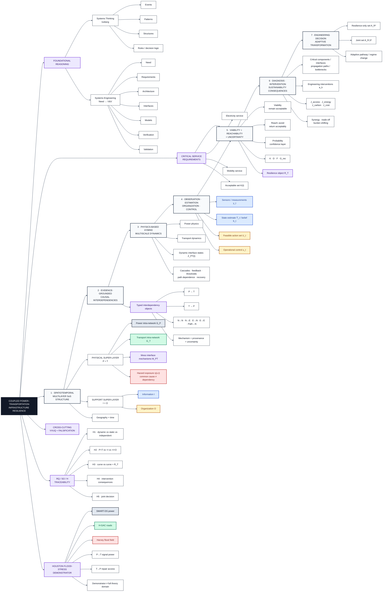
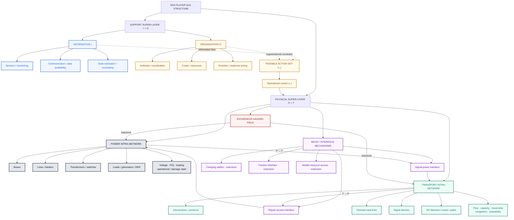
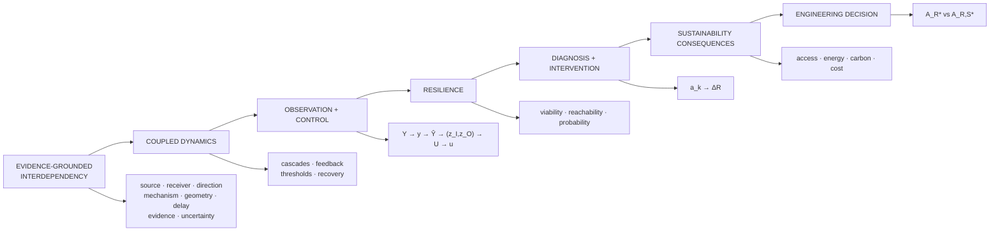
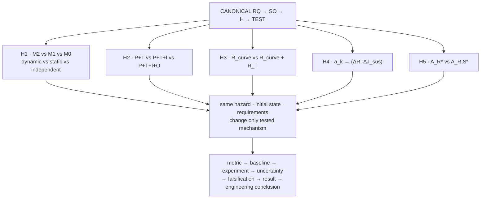
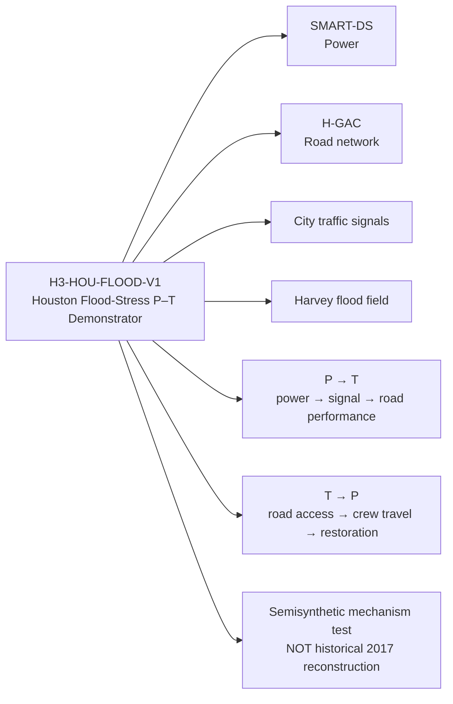

# Thesis Full Logic Mind Map — v1.0


**Figure ID:** `FIG-MINDMAP-THESIS-LOGIC-V1`  
**Status:** `DRAFT-UNVERIFIED`  
**Evidence state:** `[D]` derived synthesis of frozen thesis objects  
**Canonical scientific authority:** [`../project/CANONICAL_7_STAGE_FRAMEWORK_V2.md`](../project/CANONICAL_7_STAGE_FRAMEWORK_V2.md)  
**RQ/SO/H authority:** [`../project/CANONICAL_RQ_SO_HYPOTHESES_V2.md`](../project/CANONICAL_RQ_SO_HYPOTHESES_V2.md)  
**Visual QA authority:** [`FRAMEWORK_VISUAL_FIDELITY_PROTOCOL.md`](FRAMEWORK_VISUAL_FIDELITY_PROTOCOL.md)  

> **Guardrail:** this mind map organizes thesis content. It does **not** create 14 new framework stages. The canonical scientific spine remains the frozen seven-stage framework.

---

## 0. Central thesis identity

```math
\boxed{
\text{Coupled Power--Transportation Infrastructure Resilience}
=
\underbrace{\text{Interdependent System of Systems}}_{\text{architecture}}
+
\underbrace{\text{Complex Dynamical System}}_{\text{behavior}}
}
```

Physical core:

```math
\boxed{P+T}
```

Supporting layers:

```math
\boxed{I+O}
```

Critical-service requirements are an **input**, not an eighth stage.

---

# 1. Master mind map



---

# 2. Physical + support architecture branch

This branch resolves the two principal super-layers without collapsing intra-, meso-, inter-, and support mechanisms.



### Physical representation

```math
\boxed{
\mathfrak G_{\rm phys}
=
\left(
\mathcal G_P,
\mathcal G_T,
\mathcal M_{PT},
\mathbb I_{PT}
\right)
}
```

with

```math
\mathcal G_P=(V_P,E_P,\Phi_P),
\qquad
\mathcal G_T=(V_T,E_T,\Phi_T).
```

The meso set is an interface scale, **not a third infrastructure**.

Hazard exposure is exogenous:

```math
\boxed{\eta(x,t)\rightarrow P,T\quad\text{but}\quad\text{common exposure}\neq\text{causal dependency}.}
```

---

# 3. Causality → dynamics → resilience → decision branch



Canonical state and dynamics:

```math
Y(t)=
\begin{bmatrix}
x_P(t)\\
x_T(t)\\
z_I(t)\\
z_O(t)
\end{bmatrix},
\qquad
\boxed{
\dot Y
=
F_{\mathcal G}^{m}
\left(Y,u,\eta;\mathbb I\right)
}.
```

Canonical resilience composition:

```math
\boxed{
\text{Resilience}
=
\underbrace{\text{Viability}}_{\text{remain}}
+
\underbrace{\text{Reachability}}_{\text{return}}
+
\underbrace{\text{Probability}}_{\text{confidence}}
}
```

The `+` symbols denote conceptual composition, not arithmetic addition.

---

# 4. Research-test branch



Thesis-wide traceability rule:

```math
\boxed{
RQ_i
\rightarrow
SO_i
\rightarrow
H_i
\rightarrow
\text{mechanism}
\rightarrow
\text{metric}
\rightarrow
\text{baseline}
\rightarrow
\text{experiment}
\rightarrow
\text{uncertainty}
\rightarrow
\text{falsification}
\rightarrow
\text{engineering conclusion}
}
```

---

# 5. Houston demonstrator branch



Primary active physical interfaces:

```math
\boxed{
\mathcal M_{PT}^{HOU}
=
\{m^{sig},m^{repair}\}
}
```

with

```math
\boxed{P\rightarrow m^{sig}\rightarrow T}
```

and

```math
\boxed{T\rightarrow m^{repair}\rightarrow P.}
```

---

# 6. Compact hierarchy for XMind / presentation conversion

```text
Coupled Power–Transportation Infrastructure Resilience
├── Foundational Reasoning
│   ├── Systems Thinking / Iceberg
│   │   ├── Events
│   │   ├── Patterns
│   │   ├── Structures
│   │   └── Rules / decision logic
│   └── Systems Engineering
│       ├── Need + requirements
│       ├── Architecture + interfaces
│       └── Models + verification + validation
├── Critical Service Requirements [input]
├── Stage 1 · Spatiotemporal Multilayer SoS Structure
│   ├── Physical Super-Layer P+T
│   │   ├── Power intra-network
│   │   ├── Transport intra-network
│   │   ├── Meso interfaces
│   │   └── Hazard exposure [separate common cause]
│   └── Support Super-Layer I+O
│       ├── Information
│       └── Organization
├── Stage 2 · Evidence-Grounded Causal Interdependencies
│   ├── P→T
│   ├── T→P
│   ├── Geometry
│   └── Mechanism + provenance + uncertainty
├── Stage 3 · Physics-Based Hybrid Multiscale Dynamics
│   ├── Power physics
│   ├── Transport dynamics
│   ├── Interface states
│   └── Cascades + feedback + recovery
├── Stage 4 · Observation, State Estimation, Organization and Control
│   ├── Measurement
│   ├── State estimate / belief
│   ├── Feasible action set
│   └── Operational control
├── Stage 5 · Uncertainty-Aware Viability and Reachability Resilience
│   ├── Viability
│   ├── Reach–avoid
│   ├── Probability
│   └── K / D / F / G_rec
├── Stage 6 · Resilience Diagnosis, Intervention and Sustainability Consequences
│   ├── Diagnosis
│   ├── Intervention a_k
│   ├── Δ resilience
│   └── Access / energy / carbon / cost
├── Stage 7 · Engineering Decision and Adaptive Transformation
│   ├── A_R*
│   ├── A_R,S*
│   └── Adaptive pathways
├── RQ / SO / H Testing
│   ├── H1
│   ├── H2
│   ├── H3
│   ├── H4
│   └── H5
├── VVUQ + Falsification [cross-cutting]
└── Houston Demonstrator
    ├── SMART-DS power
    ├── H-GAC roads
    ├── Traffic signals
    ├── Harvey flood field
    ├── P→T signal-power interface
    └── T→P repair-access interface
```

---

# 7. Figure interpretation rules

1. **Seven stages remain authoritative.** Foundations, service requirements, VVUQ, hypotheses, and the Houston case are not additional stages.
2. **SoS = architecture; complex system = behavior.**
3. **P and T are physical; I and O are supporting.**
4. **Intra-network, meso-interface, and inter-network relationships are distinct.**
5. **Common hazard exposure is not a causal P↔T dependency.**
6. **Operational control `u(t)` is distinct from strategic intervention `a_k`.**
7. **Probability qualifies viability/reachability; it is not a separate resilience score.**
8. **Houston is a semisynthetic demonstrator, not the full validity domain.**
9. **Extensions such as EV/V2G/rail/mobile resources remain general-framework possibilities, not active H3 mechanisms.**
10. **No quantitative performance claim is implied by this map.**

---

# 8. Visual-production metadata

| Field | Value |
|---|---|
| Figure ID | `FIG-MINDMAP-THESIS-LOGIC-V1` |
| Scientific authority | `project/CANONICAL_7_STAGE_FRAMEWORK_V2.md` |
| RQ/H authority | `project/CANONICAL_RQ_SO_HYPOTHESES_V2.md` |
| Evidence state | `[D]` |
| Data status | conceptual architecture |
| Render | GitHub Mermaid |
| Color semantics | P navy; T teal; I blue; O amber; hazard red; derived/interface purple |
| Limitation | organizational map; does not itself validate mechanisms or hypotheses |
| Current status | `DRAFT-UNVERIFIED` |

## Required QA before `CANONICAL-VERIFIED`

```text
Stage identity:        PASS required
Stage order:           PASS required
Notation:              PASS required
Physical/support split:PASS required
Intra/meso/inter split:PASS required
Hazard semantics:      PASS required
RQ/H traceability:     PASS required
No silent additions:   PASS required
```