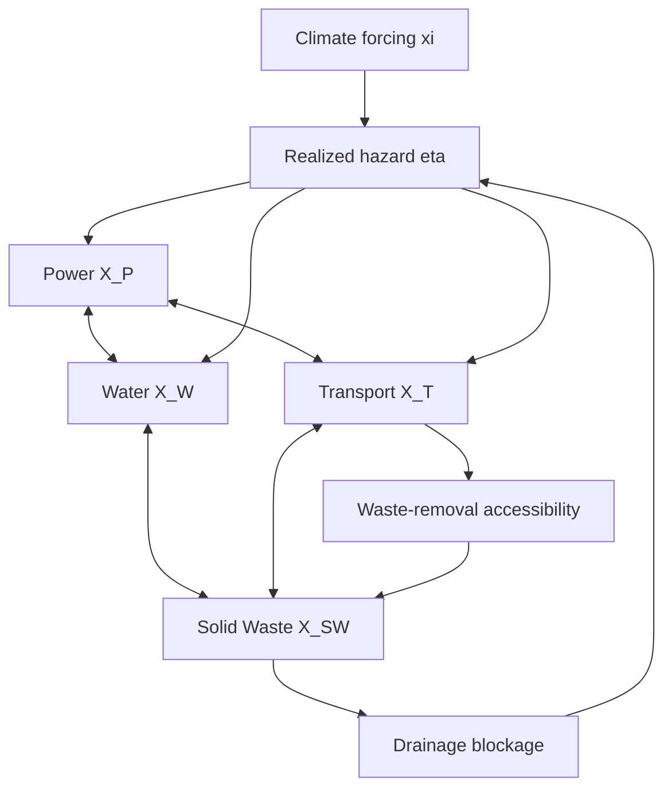

# Architecture Methods

This directory contains the executable/specification layer for the thesis architecture.

## Language roles

| Language / format | Role |
|---|---|
| **Markdown + LaTeX** | Formal scientific definitions, hypotheses, and derivations |
| **SVG** | Version-controlled mathematical art and state-space geometry |
| **Python** | Auditable numerical baselines, geometry metrics, smoke tests, figure generation |
| **Julia** | Compact dynamical-systems / multiscale model scaffold |
| **YAML** | Machine-readable scientific proposition registry |
| **JSON Schema** | Formal structural contract for model configurations |
| **GitHub Actions YAML** | Continuous reproducibility and structural QA |

No language is included for decoration; each has a specific research-engineering function.

## Core files

- `viability_geometry.py` — finite-grid viability and Hausdorff-distance reference implementation for synthetic QA.
- `CoupledInfrastructure.jl` — four-sector dynamic/interface scaffold with climate/waste feedback.
- `../../project/MATHEMATICAL_FOUNDATION.md` — governing mathematical specification.
- `../../project/SCIENTIFIC_PROPOSITIONS.md` — falsifiable proposition layer.
- `../../config/scientific_propositions.yaml` — machine-readable proposition registry.
- `../../schemas/thesis_model.schema.json` — model-configuration schema.
- `../../assets/math-art/` — repository-native mathematical figures.

## Governing architecture

```mermaid
flowchart LR
    O[Observations D_obs] --> I[Interface / parameter identification]
    I --> UQ[Uncertainty Sigma_theta]
    UQ --> D[Dynamic coupled model F_dyn]
    D --> K[Admissible set K_R]
    K --> V[Viability kernel V_R]
    V --> C[Recovery / capture geometry C_R, tau_R]
    C --> U[Viability / recovery control]
    U --> DES[Design variables d]
    DES --> OPT[Optimization / decision]
```

## P–W–T–SW interface structure

The arrows in these diagrams are hypotheses/mechanisms to be specified and tested, not automatically established causal facts.

## Numerical QA philosophy

The Python reference implementation is deliberately conservative:

1. finite-dimensional;
2. finite-horizon;
3. deterministic;
4. explicit about approximation;
5. used only for unit tests and synthetic demonstrations.

It must not be mistaken for the final viability solver. Higher-dimensional Hamilton–Jacobi, reachability, stochastic, robust, hybrid, or set-oriented methods may later replace or augment it after the governing model and data support are fixed.

## Reproducibility

`.github/workflows/scientific-architecture-qa.yml` automatically checks:

- Python syntax;
- numerical geometry smoke tests;
- YAML proposition integrity;
- JSON Schema validity;
- SVG well-formedness.
