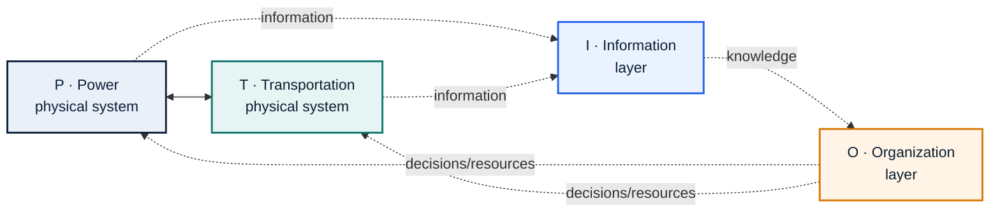

# Architecture Methods

This directory contains **small, auditable computational scaffolds** for the frozen thesis architecture. It is an implementation-support layer, not a second scientific source of truth.

Canonical scientific authority remains in:

- [`../../project/THESIS_SCOPE.md`](../../project/THESIS_SCOPE.md)
- [`../../project/CANONICAL_7_STAGE_FRAMEWORK.md`](../../project/CANONICAL_7_STAGE_FRAMEWORK.md)
- [`../../project/MATHEMATICAL_FOUNDATION.md`](../../project/MATHEMATICAL_FOUNDATION.md)
- [`../../project/RESEARCH_HYPOTHESES.md`](../../project/RESEARCH_HYPOTHESES.md)

---

## 1. Language and format roles

| Language / format | Research-engineering role |
|---|---|
| **Markdown + LaTeX** | exact definitions, equations, hypotheses, assumptions and audit records |
| **Python** | transparent numerical baselines, geometry utilities, tests and repository QA |
| **Julia** | compact dynamical-systems / multiscale implementation scaffolds |
| **YAML** | machine-readable proposition and hypothesis registries |
| **JSON + JSON Schema** | formal configuration contract and validation |
| **Mermaid** | repository architecture/navigation diagrams only |
| **SVG** | version-controlled vector figures and mathematical diagrams |
| **GitHub Actions YAML** | continuous syntax, schema, ontology and display-quality checks |

Each language has a defined function. No language is included only for decoration.

---

## 2. Canonical system interface

The active thesis system is

$$
\mathcal S=\{P,T,I,O\},
$$

where $P,T$ are the physical Power and Transportation systems and $I,O$ are informational and organizational layers.

The diagram is a navigation aid. Formal causal admissibility remains governed by the Stage-2 object $\mathfrak I_{ij}^{\alpha\beta}$; an arrow in a diagram is not evidence by itself.

---

## 3. Seven-stage computational chain

The corresponding mathematical handoff is

$$
\mathcal S
\rightarrow
\mathfrak I
\rightarrow
F_{\mathcal G}^{m}
\rightarrow
u(t)
\rightarrow
\mathcal V_{\rm sus}^{u,T}
\rightarrow
\Phi_{\rm ST}
\rightarrow
\mathfrak P_{\rm ST}.
$$

---

## 4. Core executable files

| File | Purpose | Scientific status |
|---|---|---|
| `CoupledInfrastructure.jl` | transparent P–T–I–O toy dynamics for syntax/interface tests | software-QA scaffold only |
| `viability_geometry.py` | finite-grid viability and geometric-distance reference utilities | numerical baseline / smoke test only |
| `../../config/example_model.json` | valid P–T–I–O example configuration | illustrative configuration |
| `../../schemas/thesis_model.schema.json` | machine-readable configuration contract | repository QA contract |
| `../../config/scientific_propositions.yaml` | machine-readable P1–P10 registry | synchronized proposition registry |
| `../../config/research_hypotheses.yaml` | machine-readable H1–H5 registry | synchronized hypothesis registry |
| `../../tools/thesis_display_lint.py` | Markdown/math/ontology consistency linter | repository QA tool |

None of these toy/scaffold files constitutes empirical validation or a final case-study model.

---

## 5. Numerical QA philosophy

The current numerical helpers are deliberately conservative:

1. low-dimensional and transparent;
2. finite-horizon where applicable;
3. explicit about approximation and synthetic parameters;
4. easy to test independently;
5. replaceable when the validated numerical demonstrator is specified.

A toy finite-grid viability calculation, for example, does **not** establish the final high-dimensional Stage-5 viability result. It checks code paths, geometry conventions and reproducibility.

---

## 6. Reproducibility and continuous QA

`.github/workflows/scientific-architecture-qa.yml` checks the active scientific/implementation layer for:

- Python syntax and numerical smoke tests;
- active Markdown mathematical-rendering rules;
- stale ontology terms in active authority/configuration files;
- proposition and hypothesis registry integrity;
- JSON Schema validity and example-configuration compliance;
- SVG well-formedness;
- Julia P–T–I–O scaffold execution.

Historical and provenance folders are intentionally excluded from ontology rewriting: preserving superseded material in history is different from allowing it to control the active thesis.

---

## 7. Implementation boundary

The governing rule is

$$
\text{software scaffold}
\neq
\text{validated scientific model}.
$$

A computational component becomes part of the thesis evidence only after its governing equations, parameters, units, boundary conditions, verification, validation, uncertainty treatment and provenance satisfy the quantitative reporting standard in [`../APA_JARS_QUANT_ADAPTED_REPORTING_STANDARD.md`](../APA_JARS_QUANT_ADAPTED_REPORTING_STANDARD.md).
