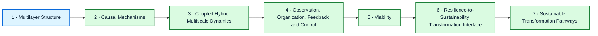

# Canonical 7-Stage Thesis Framework

**Effective date:** 2026-09-09  
**Final framework freeze:** 2026-09-11  
**Degree:** Master of Science in Engineering (MSE), Sustainable Engineering  
**Scope:** Complete conceptual and mathematical thesis framework  
**Change control:** Stages 1–7 are now frozen. Any scientific revision requires explicit approval, versioning, Git history, and re-audit of dependent files and figures.  
**Representation rule:** Visual redesign may change hierarchy, layout, typography, geometry, spacing, and graphical encoding, but it may not change scientific content.

---

## 1. Canonical sequence

$$
1\rightarrow2\rightarrow3\rightarrow4\rightarrow5\rightarrow6\rightarrow7.
$$

The seven stages are:

1. **Multilayer Structure**
2. **Causal Mechanisms**
3. **Coupled Hybrid Multiscale Dynamics**
4. **Observation, Organization, Feedback and Control**
5. **Viability**
6. **Resilience-to-Sustainability Transformation Interface**
7. **Sustainable Transformation Pathways**

The central separation remains

$$
\underbrace{\text{Stages 1--5}}_{\text{resilience analysis}}
\rightarrow
\underbrace{\text{Stage 6}}_{\text{transformation diagnosis}}
\rightarrow
\underbrace{\text{Stage 7}}_{\text{adaptive transformation pathways}}.
$$

---

## 2. Visual status map

Blue identifies the canonical system-definition stage; green identifies frozen scientific scopes. Text labels remain authoritative; color is only a secondary visual cue.

---

## 3. Canonical stage content

| Stage | Role | Main question | Status |
|---|---|---|---|
| **1. Multilayer Structure** | Define the P–T–I–O ontology, states, subsystems and possible interaction locations. | **What exists, and where can interaction occur?** | Frozen / canonical |
| **2. Causal Mechanisms** | Define directed cross-layer causal interdependencies. | **Why and through what mechanism does one component/layer affect another?** | Frozen |
| **3. Coupled Hybrid Multiscale Dynamics** | Evolve accepted mechanisms through heterogeneous dynamics, delays, events, modes, topology and timescales. | **How, when and where do effects evolve and propagate?** | Frozen |
| **4. Observation, Organization, Feedback and Control** | Reconstruct system state under imperfect information and map knowledge plus organizational capability into feasible intervention. | **How is the system observed, interpreted, coordinated and controlled?** | Frozen |
| **5. Viability** | Evaluate acceptable and maintainable operation under admissible control and uncertainty. | **Under what conditions can acceptable functions be maintained, and how far and how long is the system from unacceptable states?** | Frozen as Controlled Sustainable Viability |
| **6. Resilience-to-Sustainability Transformation Interface** | Diagnose whether preserving the current regime remains adequate and specify what must change and how deeply. | **When is recovery insufficient, and what conditions require adaptation or transformation?** | Frozen as Resilience-to-Sustainability Transition |
| **7. Sustainable Transformation Pathways** | Determine adaptive, feasible and robust sequences of strategic interventions that transform the infrastructure regime. | **What sequence of interventions leads to a more resilient, equitable and sustainable future system?** | **Frozen** |

---

## 4. Stage-6 → Stage-7 boundary

Stage 6 provides

$$
\Gamma_6
=
(c_6,\mathcal D_6,\boldsymbol\zeta_T),
$$

where Stage 6 answers

$$
\text{WHY change}
+
\text{WHAT must change}
+
\text{HOW DEEP}.
$$

Stage 7 answers

$$
\text{WHICH intervention}
+
\text{IN WHAT ORDER}
+
\text{WHEN}
+
\text{UNDER WHAT CONDITIONS}.
$$

This separation is frozen.

---

## 5. Frozen Stage-7 system-regime object

Stage 4 controls the state of the current infrastructure regime:

$$
Y\rightarrow Y'.
$$

Stage 7 transforms the regime itself:

$$
\mathcal M_k\rightarrow\mathcal M_{k+1}.
$$

The frozen Stage-7 regime object is

$$
\mathcal M_k
=
\left(
\mathcal S_k,
\mathcal G_k,
\mathfrak I_k,
F_k,
\boldsymbol\theta_k,
\mathcal U_k
\right).
$$

A transformation may therefore change topology, causal interdependencies, hybrid dynamics, capacities/parameters and future operational control capability.

---

## 6. Frozen Stage-7 topology-of-topologies architecture

Three topological levels are distinguished.

### Level I — topology inside each system

$$
G^\alpha=(V^\alpha,E^\alpha),
\qquad
\alpha\in\{P,T,I,O\}.
$$

### Level II — multilayer infrastructure topology

$$
\mathcal G
=
\left(
\{G^\alpha\}_{\alpha\in\mathcal L},
\{E^{\alpha\beta}\}_{\alpha,\beta\in\mathcal L}
\right),
\qquad
\mathcal L=\{P,T,I,O\}.
$$

### Level III — graph of alternative infrastructure regimes

$$
\mathbb G_{\rm ST}
=
(\mathbb V_{\rm ST},\mathbb E_{\rm ST}),
$$

with

$$
v_k\equiv\mathcal M_k
$$

and

$$
\mathcal M_k
\xrightarrow{a_{k\ell}}
\mathcal M_\ell.
$$

This Stage-7 meta-graph is a proposed thesis construct `[P]` built from established multilayer-network mathematics.

---

## 7. Frozen Stage-7 transformation and intervention space

The regime transformation is

$$
\mathcal M_{k+1}
=
\mathcal T_{a_k}(\mathcal M_k,\xi_k).
$$

The strategic intervention vector is

$$
a_k
=
[a_k^P,a_k^T,a_k^I,a_k^O,a_k^{\mathfrak I}].
$$

The distinction from Stage-4 operational control is mandatory:

$$
\underbrace{u(t)}_{\text{Stage 4}}
=\text{operate the current regime},
$$

$$
\underbrace{a_k}_{\text{Stage 7}}
=\text{change the regime that will subsequently be operated}.
$$

Stage 7 may directly transform Stage-2 interdependency properties:

$$
\mathfrak I_{ij}^{\alpha\beta}
\rightarrow
{\mathfrak I'}_{ij}^{\alpha\beta}.
$$

---

## 8. Frozen adaptive decision rule and trigger structure

A fixed sequence is retained only as a realized pathway. The fundamental decision rule is adaptive:

$$
a_k
=
\pi_k
\left(
\widehat Y_k,
z_{I,k},
z_{O,k},
\mathcal M_k,
\mathcal H_k
\right),
$$

with

$$
\boldsymbol\pi
=
\{\pi_0,\pi_1,\ldots,\pi_N\}.
$$

For monitored signpost

$$
s_j(t)
=
s_j\left(\widehat Y(t),z_I(t),z_O(t),\mathcal M(t),\xi(t)\right),
$$

a trigger region $\Gamma_j$ produces

$$
\tau_j
=
\inf\{t:s_j(t)\in\Gamma_j\}.
$$

Hence

$$
\text{observe}
\rightarrow
\text{update}
\rightarrow
\text{detect trigger}
\rightarrow
\text{select intervention}.
$$

---

## 9. Frozen transformation timing and path dependence

Stage 7 distinguishes

$$
t_k,
\ell_k,
d_k,
\tau_k,
T,
$$

where these respectively denote decision/initiation time, implementation lead time, intervention duration, trigger time and planning horizon.

The intervention activation time is

$$
t_k^{\rm active}=t_k+\ell_k.
$$

The available intervention space is history dependent:

$$
\mathcal A_{k+1}
=
\mathcal A(\mathcal M_{k+1},\mathcal H_{t_{k+1}}),
$$

and in general

$$
\mathcal T_{a_2}\circ\mathcal T_{a_1}
\neq
\mathcal T_{a_1}\circ\mathcal T_{a_2}.
$$

Therefore **order matters**.

---

## 10. Frozen feasibility architecture

The feasible Stage-7 action set is

$$
\mathcal A_k^{\rm feas}
=
\mathcal A_k^{\rm tech}
\cap
\mathcal A_k^{\rm budget}
\cap
\mathcal A_k^{O}
\cap
\mathcal A_k^{\rm sus}
\cap
\mathcal A_k^{\rm equity}
\cap
\mathcal A_k^{\rm temporal}.
$$

Thus

$$
a_k\in\mathcal A_k^{\rm feas}.
$$

Budget, resource, organizational, precedence, lead-time, sustainability, equity and temporal constraints remain explicit.

---

## 11. Frozen Stage-5 constraint inside Stage 7

For every candidate regime,

$$
\mathcal V_{\rm sus}^{u,T}(\mathcal M_k)
$$

must be evaluated.

Where continuous controlled viability is required,

$$
Y(t)\in\mathcal V_{\rm sus}^{u}(\mathcal M(t)).
$$

Stage 5 therefore evaluates not only the current regime but also candidate future architectures generated by Stage 7.

---

## 12. Frozen sustainable-target set

Stage 7 does not target one exact final state. It targets a set of acceptable future regimes:

$$
\mathbb M_{\rm sus}
=
\left\{
\mathcal M:
\mathcal V_{\rm sus}^{u}(\mathcal M)
\text{ satisfies required resilience, sustainability and equity conditions}
\right\}.
$$

The transformation problem is therefore

$$
(\mathcal M_0,Y_0)
\overset{\pi}{\longrightarrow}
\mathbb M_{\rm sus},
$$

which is interpreted as a **reachability problem in infrastructure-architecture space**.

---

## 13. Frozen many-objective and uncertainty architecture

The Stage-7 objective vector is

$$
\mathbf J(\Pi)
=
\begin{bmatrix}
J_{\rm risk}\\
J_{\rm service}\\
J_{\rm cost}\\
J_{\rm carbon}\\
J_{\rm inequity}\\
J_{\rm time}\\
J_{\rm flexibility}
\end{bmatrix}.
$$

Under deep uncertainty,

$$
\Pi^\star
\in
\operatorname{RobustPareto}(\mathbf J,\Omega).
$$

The framework preserves the distinction among ordinary probabilistic uncertainty, distributional ambiguity and deep uncertainty:

$$
\xi\sim P,
\qquad
P\in\mathcal P,
\qquad
\omega\in\Omega.
$$

---

## 14. Frozen fundamental Stage-7 object

The canonical Stage-7 object is

$$
\boxed{
\mathfrak P_{\rm ST}
=
\left(
\mathbb G_{\rm ST},
\boldsymbol\pi,
\Omega,
\mathcal A^{\rm feas},
\mathbf J,
\mathbb M_{\rm sus}
\right)
}.
$$

It combines:

- the graph of alternative P–T–I–O regimes;
- the adaptive transformation policy;
- plausible futures;
- feasible transformation actions;
- many-objective evaluation; and
- the sustainable viable target-regime set.

The exact object is a proposed thesis construct `[P]`; freezing it establishes the thesis framework definition, not external theoretical validation.

---

## 15. Frozen Stage-7 dynamic formulation

$$
\begin{aligned}
a_k
&=\pi_k(\widehat Y_k,z_{I,k},z_{O,k},\mathcal M_k,\mathcal H_k),\\
\mathcal M_{k+1}
&=\mathcal T(\mathcal M_k,a_k,\xi_k),\\
\dot Y(t)
&=F_{\mathcal M_k}^{m(t)}(Y,Y(t-\delta),u,h,\xi),\\
u(t)
&\in\mathcal U(I,O,\mathcal M_k),\\
Y(t)
&\in K_{\rm sus},\\
a_k
&\in\mathcal A_k^{\rm feas},\\
\mathcal M_N
&\in\mathbb M_{\rm sus}.
\end{aligned}
$$

The realized pathway under policy $\pi$ and future $\omega$ is

$$
\Pi_{\pi,\omega}
=
[(\mathcal M_0,a_0,\tau_0),(\mathcal M_1,a_1,\tau_1),\ldots,\mathcal M_N].
$$

---

## 16. Frozen Stage-7 optimization form

The candidate computational statement is

$$
\begin{aligned}
\operatorname*{find}_{\boldsymbol\pi}\quad
&\operatorname{RobustPareto}_{\omega\in\Omega}
\;\mathbf J(\Pi_{\pi,\omega})\\
\text{s.t.}\quad
&\mathcal M_{k+1}=\mathcal T(\mathcal M_k,a_k,\xi_k),\\
&a_k=\pi_k(\widehat Y_k,z_{I,k},z_{O,k},\mathcal M_k,\mathcal H_k),\\
&\dot Y=F_{\mathcal M_k}^{m}(Y,Y_\delta,u,h,\xi),\\
&Y(t)\in K_{\rm sus},\\
&a_k\in\mathcal A_k^{\rm feas},\\
&\text{budget + resource + precedence + lead-time constraints},\\
&\mathcal M_N\in\mathbb M_{\rm sus}.
\end{aligned}
$$

This optimization architecture is `[P]` and must be validated computationally.

---

## 17. Seven-stage validation loop

Every Stage-7 transformation candidate is replayed through the upstream framework:

$$
\begin{aligned}
\text{Stage 7 candidate}
&\rightarrow\text{Stage 1 structural update}\\
&\rightarrow\text{Stage 2 mechanism update}\\
&\rightarrow\text{Stage 3 dynamic simulation}\\
&\rightarrow\text{Stage 4 observability/control evaluation}\\
&\rightarrow\text{Stage 5 viability evaluation}\\
&\rightarrow\text{Stage 6 adequacy diagnosis}\\
&\rightarrow\text{Stage 7 accept/reject/refine}.
\end{aligned}
$$

This loop validates candidate transformations; **it does not replace or reorder the seven stages**.

---

## 18. Complete frozen mathematical progression

The complete framework is

$$
\boxed{
\underbrace{\mathcal S}_{1}
\rightarrow
\underbrace{\mathfrak I}_{2}
\rightarrow
\underbrace{F_{\mathcal G}^{m}}_{3}
\rightarrow
\underbrace{X\rightarrow y\rightarrow I\rightarrow\widehat X\rightarrow O\rightarrow u}_{4}
\rightarrow
\underbrace{K_{\rm sus},\mathcal V,\rho,T_{\mathcal V},T_K}_{5}
\rightarrow
\underbrace{\Phi_{\rm ST}\rightarrow(c_6,\mathcal D_6,\boldsymbol\zeta_T)}_{6}
\rightarrow
\underbrace{\mathfrak P_{\rm ST}}_{7}
}.
$$

Its conceptual form is

$$
\boxed{
\text{ontology}
\rightarrow
\text{causal coupling}
\rightarrow
\text{dynamics}
\rightarrow
\text{knowledge/control}
\rightarrow
\text{viability}
\rightarrow
\text{transformation diagnosis}
\rightarrow
\text{adaptive transformation pathway}
}.
$$

---

## 19. Final Stage-7 interpretation

> **Stage 7 is an adaptive, viability-constrained, many-objective reachability problem over a graph of evolving P–T–I–O infrastructure architectures.**

This is the frozen conceptual/mathematical interpretation of Stage 7.

Canonical Stage-7 specification:

[`STAGE_7_SUSTAINABLE_TRANSFORMATION_PATHWAYS.md`](STAGE_7_SUSTAINABLE_TRANSFORMATION_PATHWAYS.md)

The earlier research-development file remains provenance only:

[`STAGE_7_SUSTAINABLE_TRANSFORMATION_PATHWAYS_RESEARCH.md`](STAGE_7_SUSTAINABLE_TRANSFORMATION_PATHWAYS_RESEARCH.md)

---

## 20. Scientific-content preservation rule

> **CHANGE THE VISUAL HIERARCHY, NOT THE SCIENTIFIC CONTENT.**

A framework figure may simplify layout, but it may not silently add or remove stages, redefine a frozen mathematical object, merge distinct stage responsibilities, or promote a proposed thesis construct into established theory.

---

## 21. Final change-control rule

The seven-stage conceptual and mathematical framework is now frozen.

A future revision is valid only when the change is explicitly approved, affected stage specifications and mathematical interfaces are updated, the revision is recorded in Git history, and dependent figures/project files are re-audited.

Current state:

$$
\boxed{
\textbf{STAGES 1--7: CONCEPTUAL AND MATHEMATICAL FRAMEWORK FROZEN}
}
$$

The next scientific phase is **operationalization, numerical case-study design, computation, falsification and validation**, not redesign of the seven-stage framework.
