# Canonical 7-Stage Thesis Framework

**Effective date:** 2026-09-09  
**Degree:** Master of Science in Engineering (MSE), Sustainable Engineering  
**Scope:** Thesis framework architecture and all future representations of that architecture  
**Change control:** This specification remains authoritative until an explicit, versioned framework revision is approved.  
**Representation rule:** Visual redesign may change hierarchy, layout, typography, geometry, spacing, and graphical encoding, but it may not change scientific content.

---

## 1. Canonical sequence

$$
1\rightarrow2\rightarrow3\rightarrow4\rightarrow5\rightarrow6\rightarrow7.
$$

The seven stage names are:

1. **Multilayer Structure**
2. **Causal Mechanisms**
3. **Coupled Hybrid Multiscale Dynamics**
4. **Observation, Organization, Feedback and Control**
5. **Viability**
6. **Resilience-to-Sustainability Transformation Interface**
7. **Sustainable Transformation Pathways**

The central separation is

$$
\underbrace{\text{Stages 1--5}}_{\text{resilience analysis}}
\rightarrow
\underbrace{\text{Stage 6}}_{\text{translation interface}}
\rightarrow
\underbrace{\text{Stage 7}}_{\text{sustainable transformation}}.
$$

---

## 2. Visual status map

```mermaid
flowchart LR
    S1["1 · Multilayer Structure"] --> S2["2 · Causal Mechanisms"]
    S2 --> S3["3 · Coupled Hybrid Multiscale Dynamics"]
    S3 --> S4["4 · Observation, Organization, Feedback and Control"]
    S4 --> S5["5 · Viability"]
    S5 --> S6["6 · Resilience-to-Sustainability Transformation Interface"]
    S6 --> S7["7 · Sustainable Transformation Pathways"]

    classDef canonical fill:#DDF4FF,stroke:#0969DA,color:#0B1F33,stroke-width:2px;
    classDef frozen fill:#DAFBE1,stroke:#1A7F37,color:#0B1F33,stroke-width:2px;
    classDef next fill:#FFF8C5,stroke:#9A6700,color:#0B1F33,stroke-width:2px;
    classDef downstream fill:#F6F8FA,stroke:#57606A,color:#24292F,stroke-width:1.5px;

    class S1 canonical;
    class S2,S3,S4,S5 frozen;
    class S6 next;
    class S7 downstream;
```

Blue identifies the canonical system-definition stage, green identifies frozen stages, amber identifies the next formalization stage, and gray identifies downstream work. Text labels remain authoritative; color is only a secondary visual cue.

---

## 3. Exact canonical content

| Stage | Role | Main question | Current status |
|---|---|---|---|
| **1. Multilayer Structure** | Define the P–T–I–O ontology, states, subsystems, and potential interface locations. | **What exists, and where can interaction occur?** | Defined / canonical |
| **2. Causal Mechanisms** | Define directed cross-layer causal interdependencies. | **Why and through what mechanism does one component/layer affect another?** | Frozen |
| **3. Coupled Hybrid Multiscale Dynamics** | Evolve accepted mechanisms through heterogeneous dynamics, delays, events, modes, topology, and timescales. | **How, when, and where do effects evolve and propagate?** | Frozen |
| **4. Observation, Organization, Feedback and Control** | Reconstruct system state under imperfect information and map knowledge plus organizational capability into feasible intervention. | **How is the system observed, interpreted, coordinated, and controlled?** | Frozen |
| **5. Viability** | Evaluate acceptable and maintainable operation under admissible control and uncertainty. | **Under what conditions can acceptable functions be maintained, and how far and how long is the system from unacceptable states?** | Frozen as Controlled Sustainable Viability |
| **6. Resilience-to-Sustainability Transformation Interface** | Translate only validated resilience results into sustainability-transition requirements. | **What do verified resilience results imply for sustainability?** | Next |
| **7. Sustainable Transformation Pathways** | Evaluate long-term technical, organizational, environmental, and policy transformation pathways. | **What should change for long-term sustainability?** | Downstream |

---

## 4. Canonical mathematical hierarchy

The framework-level object flow is

$$
\begin{aligned}
\{P,T,I,O\}
&\rightarrow \mathfrak I_{ij}^{\alpha\beta}
\rightarrow \{Y(t),\mathcal G(t),m(t),T_C\}\\
&\rightarrow \{\widehat X,\Sigma_X,b_t,\mathcal U,u,\tau_{\rm response}\}\\
&\rightarrow \{K_{\rm sus},\mathcal V_{\rm sus}^{u,T},\partial\mathcal V,
\rho,T_{\mathcal V},T_K\}\\
&\rightarrow \text{Stage 6 translation requirements}
\rightarrow \text{Stage 7 transformation pathways}.
\end{aligned}
$$

This hierarchy is a **cross-stage interface map**, not a substitute for the detailed definitions in the stage-specific files.

---

## 5. Frozen stage boundaries

| Boundary | Meaning |
|---|---|
| Stage 1 → Stage 2 | Structure identifies possible interaction locations; Stage 2 requires causal mechanisms. |
| Stage 2 → Stage 3 | Stage 2 identifies the causal edge; Stage 3 evolves its consequence through time and space. |
| Stage 3 → Stage 4 | Stage 3 produces the evolving system trajectory; Stage 4 determines what can be known and controlled. |
| Stage 4 → Stage 5 | Stage 4 produces feasible intervention and controlled trajectories; Stage 5 evaluates acceptability and maintainability. |
| Stage 5 → Stage 6 | Only validated resilience evidence is translated into sustainability-transition requirements. |
| Stage 6 → Stage 7 | Translation requirements constrain the transformation pathways to be evaluated. |

---

## 6. Scientific-content preservation rule

> **CHANGE THE VISUAL HIERARCHY, NOT THE SCIENTIFIC CONTENT.**

A framework figure may simplify layout, but it may not silently add or remove stages, redefine a frozen mathematical object, merge distinct stage responsibilities, or promote a proposed thesis construct into established theory.

Generated images are illustrative unless manually audited against this file and the stage-specific canonical specifications.

---

## 7. Representation authority

For future figures and documents:

1. **Scientific source of truth:** this file plus the stage-specific canonical files.
2. **Project navigation and render standard:** [`README.md`](README.md).
3. **Exact-text construction:** TikZ/LaTeX, Figma, SVG, or another deterministic vector workflow.
4. **Generative outputs:** visual inspiration or draft only unless audited against canonical content.
5. **Final thesis figures:** must pass [`../figures/FRAMEWORK_VISUAL_FIDELITY_PROTOCOL.md`](../figures/FRAMEWORK_VISUAL_FIDELITY_PROTOCOL.md).

---

## 8. Change-control rule

A future framework revision is valid only when the change is explicitly approved, the canonical stage table is updated, affected mathematical interfaces are updated, the revision is recorded in Git history, and all dependent figures and project files are re-audited.

Until then, this seven-stage specification is frozen as the thesis framework authority.
