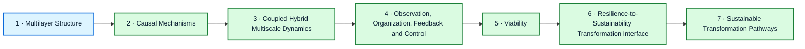

# Canonical Seven-Stage Thesis Framework


**Effective date:** 2026-09-09  
**Final framework freeze:** 2026-09-11  
**Dependency-contract synchronization:** 2026-09-12  
**Degree:** Master of Science in Engineering (MSE), Sustainable Engineering  
**Scope:** Complete conceptual and mathematical thesis framework  
**Change control:** Any scientific revision requires explicit approval, versioning, Git history and re-audit of dependent files/figures.  
**Representation rule:** Visual redesign may change hierarchy, layout, typography, geometry and color; it may not change scientific content.

> **Synchronization rule:** The seven-stage sequence and responsibilities remain frozen. The 2026-09-12 update changes only the canonical Stage-2 dependency representation in accordance with Phase-0 Gate v1.0.

---

## 1. Frozen sequence

1. **Multilayer Structure**
2. **Causal Mechanisms**
3. **Coupled Hybrid Multiscale Dynamics**
4. **Observation, Organization, Feedback and Control**
5. **Viability**
6. **Resilience-to-Sustainability Transformation Interface**
7. **Sustainable Transformation Pathways**

The sequence is

```math
1\rightarrow2\rightarrow3\rightarrow4\rightarrow5\rightarrow6\rightarrow7.
```



Blue marks the canonical ontology stage; green marks frozen scientific scopes. Text labels remain authoritative if color is unavailable.

---

## 2. Stage responsibilities

| Stage | Main responsibility | Frozen question |
|---|---|---|
| **1 — Multilayer Structure** | define P–T–I–O ontology, states, subsystems and possible interaction locations | **What exists, and where can interaction occur?** |
| **2 — Causal Mechanisms** | define directed cross-layer causal dependencies/interdependencies through the canonical dependency contract | **Why and through what mechanism does one component/layer affect another?** |
| **3 — Coupled Hybrid Multiscale Dynamics** | evolve accepted mechanisms through heterogeneous dynamics, delays, events, modes, topology and timescales | **How, when and where do effects evolve and propagate?** |
| **4 — Observation, Organization, Feedback and Control** | reconstruct system state and map information/organization into feasible operational action | **How is the system observed, interpreted, coordinated and controlled?** |
| **5 — Viability** | evaluate acceptability, maintainability and proximity to loss | **Under what conditions can acceptable functions be maintained, and how far and how long is the system from unacceptable states?** |
| **6 — Resilience-to-Sustainability Transformation Interface** | diagnose current-regime adequacy and specify why/what/how-deep change is required | **When is recovery insufficient, and what conditions require adaptation or transformation?** |
| **7 — Sustainable Transformation Pathways** | determine adaptive, feasible and robust strategic transformation pathways | **What sequence of interventions leads to a more resilient, equitable and sustainable future system?** |

---

## 3. Frozen system ontology

```math
\mathcal S=\{P,T,I,O\},
```

with

```math
P,T=\text{physical infrastructure systems},
\qquad
I,O=\text{informational and organizational layers}.
```

The integrated state is

```math
Y(t)=
\begin{bmatrix}
x_P(t)\\x_T(t)\\z_I(t)\\z_O(t)
\end{bmatrix},
```

and the physical state is

```math
X(t)=
\begin{bmatrix}
x_P(t)\\x_T(t)
\end{bmatrix}.
```

---

## 4. Stage 2 — canonical causal dependency contract

Every accepted directed dependency is represented by

```math
\boxed{
\mathfrak d_e
=
(\mathcal C_e,\Sigma_e,\Pi_e)
}
```

with

```math
\mathcal C_e
=
(s_e,p_e^s,r_e,p_e^r,\chi_e),
```

```math
\Sigma_e
=
(\Phi_e,\gamma_e,\theta_e,\zeta_e),
```

```math
\Pi_e
=
(\mathcal P_e,V_e,\mathcal U_e).
```

Interpretation:

```text
C_e = typed source/receiver, interface points and exchanged carrier/signal/authority;
Sigma_e = explicit causal mechanism, activation/context, parameters and optional relation state/memory;
Pi_e = provenance, validation/evidence state and epistemic/parameter uncertainty.
```

The active dependency/interdependency set is

```math
\mathbb I(t)
=
\{\mathfrak d_e(t):e\in\mathcal E(t)\}.
```

A retained relation requires an explicit causal mechanism. Common hazard exposure or correlation alone does not establish a directed dependency.

The causal semantics must preserve the receiving domain physics. For a continuous receiving system,

```math
\dot x_r
=
F_r(x_r,u_r,h_r;\vartheta_r)
+
\gamma_e\Phi_e(x_s,x_r,\zeta_e,\nu;\theta_e).
```

For event-driven/organizational mechanisms, use a declared hybrid transition under the corresponding guard.

Executable realization and service consequence remain separate:

```math
\mathcal X:\Sigma_e\mapsto\Xi_e,
```

```math
Q=G(Y).
```

The required engineering trace is

```math
\Delta\mathfrak d_e
\rightarrow
\Delta\dot X
\rightarrow
\Delta X
\rightarrow
\Delta Q.
```

Relation class, structural-existence indicator and influence strength are derived/reporting quantities unless a future versioned gate establishes otherwise.

> **Legacy provenance:** the former flat object $\mathfrak I_{ij}^{\alpha\beta}=(E_i^\alpha,E_j^\beta,M_{ij},w_{ij},\delta_{ij},\tau_{ij},a_{ij},m,\mathcal H_t)$ is superseded for active canonical use. See `CANONICAL_DEPENDENCY_CONTRACT_V1.md` for the migration table.

---

## 5. Stage 3 — hybrid multiscale evolution

The operating mode remains separate from the continuous/discrete system state:

```math
\widetilde Y(t)=\bigl(Y(t),m(t)\bigr).
```

Stage 3 owns delayed, hybrid, multirate and topology-dependent evolution through $F_{\mathcal G}^{m}$, including event logic, cascade timing and uncertainty where required.

The temporal discipline is

```math
\text{event time}
\neq
\text{causal delay}
\neq
\text{characteristic timescale}.
```

Stage-2 mechanism parameters and guards supply causal semantics; Stage 3 owns their evolution inside the coupled system dynamics.

---

## 6. Stage 4 — observation, organization and operational control

The feedback spine is

```math
X(t)
\rightarrow y(t)
\rightarrow I(t)
\rightarrow\widehat X(t)
\rightarrow O(t)
\rightarrow u(t)
\rightarrow X(t).
```

Feasible control is constrained by the informational and organizational states:

```math
u(t)=\pi\!\left(\widehat X(t),z_I(t),z_O(t)\right),
\qquad
u(t)\in\mathcal U\!\left(z_I(t),z_O(t)\right).
```

Here $u(t)$ is operational control. It is not the Stage-7 strategic transformation action.

---

## 7. Stage 5 — controlled sustainable viability

The acceptability set is distinct from the controlled viable set:

```math
K_{\rm sus}
\supseteq
\mathcal V_{\rm sus}^{u,T}.
```

The central implication is

```math
Y\notin\mathcal V_{\rm sus}^{u,T}
\not\Rightarrow
Y\notin K_{\rm sus}.
```

Stage-5 outputs include

```math
\partial\mathcal V,
\qquad
\rho,
\qquad
T_{\mathcal V},
\qquad
T_K,
\qquad
S_{e}^{\mathcal V},
```

with proposed quantities retaining `[P]` status until validated.

Dependency sensitivity must be defined with respect to declared mechanism parameters or perturbations in the canonical dependency contract rather than assuming a universal primitive edge weight.

---

## 8. Stage 6 — regime-adequacy translation

Stage 6 receives validated Stage-5 evidence and long-horizon requirements through

```math
\Phi_{\rm ST}
:
(\mathcal R_5,\Lambda_{\rm LT},\mathbf d_6)
\mapsto
(c_6,\mathcal D_6,\boldsymbol\zeta_T).
```

It answers

```math
\text{WHY change}
+
\text{WHAT must change}
+
\text{HOW DEEP}.
```

Its output is

```math
(c_6,\mathcal D_6,\boldsymbol\zeta_T),
```

not an intervention sequence.

---

## 9. Stage 7 — strategic transformation of regimes

Stage 7 changes the regime itself. The frozen regime object is

```math
\mathfrak M_k
=
\left(
\mathcal S_k,
\mathcal G_k,
\mathbb I_k,
F_k,
\Theta_k,
K_{{\rm sus},k},
\mathcal U_k
\right).
```

Here $\mathbb I_k$ is the regime-specific set of canonical dependency objects.

Operational and strategic actions are distinct:

```math
\underbrace{u(t)}_{\text{operate current regime}}
\neq
\underbrace{\mathbf a_k}_{\text{transform regime}}.
```

The strategic action vector is

```math
\mathbf a_k
=
\begin{bmatrix}
a_k^P\\a_k^T\\a_k^I\\a_k^O\\a_k^{\mathbb I}
\end{bmatrix},
```

and the regime transition is

```math
\mathfrak M_{k+1}
=
\mathcal T_{\mathbf a_k}(\mathfrak M_k,\xi_k).
```

The adaptive transformation policy is denoted $\boldsymbol\pi_{\rm ST}$, with step policy $\pi_k^{\rm ST}$.

---

## 10. Stage-7 graph of alternative regimes

The transformation meta-graph is

```math
\mathbb G_{\rm ST}
=
(\mathbb V_{\rm ST},\mathbb E_{\rm ST}),
```

where

```math
v_k\equiv\mathfrak M_k
```

and each edge represents an admissible strategic transformation.

A monitored trigger region $\mathcal Z_j$ produces trigger time

```math
\tau_j
=
\inf\{t\ge t_k:s_j(t)\in\mathcal Z_j\}.
```

The feasible action set includes technical, budget, informational, organizational, sustainability, equity and temporal constraints.

---

## 11. Frozen Stage-7 object

The terminal framework object is

```math
\mathfrak P_{\rm ST}
=
\left(
\mathbb G_{\rm ST},
\boldsymbol\pi_{\rm ST},
\Omega,
\mathcal A^{\rm feas},
\mathbf J,
\mathbb M_{\rm sus}
\right).
```

Stage 7 is therefore interpreted as an **adaptive, viability-constrained, many-objective reachability problem over evolving P–T–I–O infrastructure regimes**.

---

## 12. Complete frozen mathematical chain

```math
\begin{aligned}
\underbrace{\mathcal S}_{1}
&\rightarrow
\underbrace{\mathbb I=\{\mathfrak d_e\}}_{2}
\rightarrow
\underbrace{F_{\mathcal G}^{m}}_{3}\\
&\rightarrow
\underbrace{X\rightarrow y\rightarrow I\rightarrow\widehat X\rightarrow O\rightarrow u}_{4}\\
&\rightarrow
\underbrace{K_{\rm sus},\mathcal V,\rho,T_{\mathcal V},T_K}_{5}\\
&\rightarrow
\underbrace{\Phi_{\rm ST}\rightarrow(c_6,\mathcal D_6,\boldsymbol\zeta_T)}_{6}\\
&\rightarrow
\underbrace{\mathfrak P_{\rm ST}}_{7}.
\end{aligned}
```

---

## 13. Frozen stage boundaries

| Boundary | Scientific meaning |
|---|---|
| Stage 1 → 2 | possible structural relation becomes a retained dependency only after causal admissibility and evidence qualification |
| Stage 2 → 3 | accepted causal semantics are realized inside state, time, mode and topology evolution |
| Stage 3 → 4 | evolving trajectory becomes partially observed and operationally controllable |
| Stage 4 → 5 | feasible control is evaluated against acceptability and maintainability |
| Stage 5 → 6 | resilience/viability evidence is translated into regime-adequacy requirements |
| Stage 6 → 7 | why/what/how-deep change becomes which/order/when/under-what-conditions |

---

## 14. Seven-stage validation loop

Every candidate Stage-7 transformation must be replayed through the upstream framework:

```math
\begin{aligned}
\text{Stage-7 candidate}
&\rightarrow\text{Stage-1 structural update}\\
&\rightarrow\text{Stage-2 causal-mechanism/dependency update}\\
&\rightarrow\text{Stage-3 dynamic simulation}\\
&\rightarrow\text{Stage-4 observation/control evaluation}\\
&\rightarrow\text{Stage-5 viability evaluation}\\
&\rightarrow\text{Stage-6 adequacy diagnosis}\\
&\rightarrow\text{Stage-7 accept / reject / refine}.
\end{aligned}
```

The validation loop checks the stages; it does not reorder or replace them.

---

## 15. Representation authority

For final figures and documents:

1. scientific source of truth: this file, `CANONICAL_SYSTEM_DEFINITION.md`, `CANONICAL_DEPENDENCY_CONTRACT_V1.md`, plus frozen stage-specific files;
2. notation/rendering source: `MATHEMATICAL_PRESENTATION_V3.md`;
3. exact mathematical production: LaTeX/TikZ, Figma/SVG or another deterministic vector workflow;
4. computed figures: Python or Julia with source code and provenance;
5. framework visuals: must pass `../figures/FRAMEWORK_VISUAL_FIDELITY_PROTOCOL.md`.

> **COMPLETE SEVEN-STAGE CONCEPTUAL AND MATHEMATICAL FRAMEWORK: FROZEN; STAGE-2 DEPENDENCY CONTRACT SYNCHRONIZED TO v1.0.**
