# Canonical 7-Stage Thesis Framework

**Effective date:** 2026-09-09  
**Updated:** 2026-09-11  
**Degree:** Master of Science in Engineering (MSE), Sustainable Engineering  
**Scope:** Thesis framework architecture and all future representations of that architecture  
**Change control:** The seven-stage architecture is authoritative. Stage-specific scientific scopes remain version controlled; Stage 7 is not frozen yet.  
**Representation rule:** Visual redesign may change hierarchy, layout, typography, geometry, spacing, and graphical encoding, but it may not change scientific content.

---

## 1. Canonical sequence

$$
1\rightarrow2\rightarrow3\rightarrow4\rightarrow5\rightarrow6\rightarrow7.
$$

The seven stage names are:

1. **Multilayer Structure**
2. **Causal Mechanisms**
3. **Coupled Hybrid Multiscale Dynamics**
4. **Observation, Organization, Feedback and Control**
5. **Viability**
6. **Resilience-to-Sustainability Transformation Interface**
7. **Sustainable Transformation Pathways**

The central separation is

$$
\underbrace{\text{Stages 1--5}}_{\text{resilience analysis}}
\rightarrow
\underbrace{\text{Stage 6}}_{\text{translation interface}}
\rightarrow
\underbrace{\text{Stage 7}}_{\text{sustainable transformation pathways}}.
$$

---

## 2. Visual status map

```mermaid
flowchart LR
    S1["1 · Multilayer Structure"] --> S2["2 · Causal Mechanisms"]
    S2 --> S3["3 · Coupled Hybrid Multiscale Dynamics"]
    S3 --> S4["4 · Observation, Organization, Feedback and Control"]
    S4 --> S5["5 · Viability"]
    S5 --> S6["6 · Resilience-to-Sustainability Transformation Interface"]
    S6 --> S7["7 · Sustainable Transformation Pathways"]

    classDef canonical fill:#DDF4FF,stroke:#0969DA,color:#0B1F33,stroke-width:2px;
    classDef frozen fill:#DAFBE1,stroke:#1A7F37,color:#0B1F33,stroke-width:2px;
    classDef research fill:#FFF8C5,stroke:#9A6700,color:#0B1F33,stroke-width:2px;

    class S1 canonical;
    class S2,S3,S4,S5,S6 frozen;
    class S7 research;
```

Blue identifies the canonical system-definition stage, green identifies frozen scientific scopes, and amber identifies the active Stage-7 research scope. Text labels remain authoritative; color is only a secondary visual cue.

---

## 3. Canonical stage content and current status

| Stage | Role | Main question | Current status |
|---|---|---|---|
| **1. Multilayer Structure** | Define the P–T–I–O ontology, states, subsystems, and potential interface locations. | **What exists, and where can interaction occur?** | Defined / canonical |
| **2. Causal Mechanisms** | Define directed cross-layer causal interdependencies. | **Why and through what mechanism does one component/layer affect another?** | Frozen |
| **3. Coupled Hybrid Multiscale Dynamics** | Evolve accepted mechanisms through heterogeneous dynamics, delays, events, modes, topology, and timescales. | **How, when, and where do effects evolve and propagate?** | Frozen |
| **4. Observation, Organization, Feedback and Control** | Reconstruct system state under imperfect information and map knowledge plus organizational capability into feasible intervention. | **How is the system observed, interpreted, coordinated, and controlled?** | Frozen |
| **5. Viability** | Evaluate acceptable and maintainable operation under admissible control and uncertainty. | **Under what conditions can acceptable functions be maintained, and how far and how long is the system from unacceptable states?** | Frozen as Controlled Sustainable Viability |
| **6. Resilience-to-Sustainability Transformation Interface** | Diagnose whether preserving the present regime remains adequate; translate Stage-5 evidence and long-horizon requirements into recovery/adaptation/transformation requirements. | **When is recovery insufficient, and what conditions require adaptation or transformation?** | **Frozen as Resilience-to-Sustainability Transition** |
| **7. Sustainable Transformation Pathways** | Determine which strategic interventions can satisfy Stage-6 requirements, and how they should be sequenced under feasibility and uncertainty. | **What sequence of interventions leads to a more resilient, equitable and sustainable future system?** | **Deep research complete; scope not frozen** |

---

## 4. Canonical mathematical hierarchy through Stage 6

The frozen framework interface through Stage 6 is

$$
\begin{aligned}
\{P,T,I,O\}
&\rightarrow \mathfrak I_{ij}^{\alpha\beta}
\rightarrow \{Y(t),\mathcal G(t),m(t),T_C\}\\
&\rightarrow \{\widehat X,\Sigma_X,b_t,\mathcal U,u,\tau_{\mathrm{response}}\}\\
&\rightarrow \{K_{\mathrm{sus}},\mathcal V_{\mathrm{sus}}^{u,T},\partial\mathcal V,
\rho,T_{\mathcal V},T_K\}\\
&\rightarrow \Phi_{\mathrm{ST}}
\rightarrow (c_6,\mathcal D_6,\boldsymbol{\zeta}_T).
\end{aligned}
$$

The Stage-6 translation is

$$
\Phi_{\mathrm{ST}}
:
(\mathcal R_5,\Lambda_{\mathrm{LT}},\mathbf d_6)
\mapsto
(c_6,\mathcal D_6,\boldsymbol{\zeta}_T).
$$

The frozen Stage-6 output is the formal handoff to Stage 7:

$$
(c_6,\mathcal D_6,\boldsymbol{\zeta}_T)
\longrightarrow
\text{Stage-7 candidate interventions and pathways}.
$$

The exact Stage-7 mathematical object remains under research and is **not canonical yet**. Candidate formulations are documented in `STAGE_7_SUSTAINABLE_TRANSFORMATION_PATHWAYS_RESEARCH.md`.

---

## 5. Frozen stage boundaries

| Boundary | Meaning |
|---|---|
| Stage 1 → Stage 2 | Structure identifies possible interaction locations; Stage 2 requires causal mechanisms. |
| Stage 2 → Stage 3 | Stage 2 identifies the causal edge; Stage 3 evolves its consequence through time and space. |
| Stage 3 → Stage 4 | Stage 3 produces the evolving system trajectory; Stage 4 determines what can be known and controlled. |
| Stage 4 → Stage 5 | Stage 4 produces feasible intervention and controlled trajectories; Stage 5 evaluates acceptability and maintainability. |
| Stage 5 → Stage 6 | Stage 6 asks whether the present decision/system space remains adequate under long-horizon sustainability, equity, lock-in and adaptation-limit evidence. |
| Stage 6 → Stage 7 | Stage 6 defines **why/what/how-deep** change must be; Stage 7 determines **which interventions/in what order/when/under what constraints**. |

---

## 6. Stage-6 authority

The frozen Stage-6 scientific specification is:

[`STAGE_6_RESILIENCE_TO_SUSTAINABILITY_TRANSITION.md`](STAGE_6_RESILIENCE_TO_SUSTAINABILITY_TRANSITION.md)

Its principal output is

$$
(c_6,\mathcal D_6,\boldsymbol{\zeta}_T),
$$

not an intervention sequence.

---

## 7. Stage-7 research status

Stage 7 is currently governed by the research file

[`STAGE_7_SUSTAINABLE_TRANSFORMATION_PATHWAYS_RESEARCH.md`](STAGE_7_SUSTAINABLE_TRANSFORMATION_PATHWAYS_RESEARCH.md).

The research question is retained, but the exact mathematical scope is **not frozen**. In particular, the research is testing whether a deterministic sequence

$$
\Pi=[(a_1,t_1),\ldots,(a_N,t_N)]
$$

is sufficient, or whether the fundamental object should instead be an adaptive, trigger-dependent pathway graph under deep uncertainty.

No candidate Stage-7 construct becomes canonical until an explicit Stage-7 freeze is approved.

---

## 8. Scientific-content preservation rule

> **CHANGE THE VISUAL HIERARCHY, NOT THE SCIENTIFIC CONTENT.**

A framework figure may simplify layout, but it may not silently add or remove stages, redefine a frozen mathematical object, merge distinct stage responsibilities, or promote a proposed thesis construct into established theory.

Generated images are illustrative unless manually audited against this file and the stage-specific canonical specifications.

---

## 9. Representation authority

For future figures and documents:

1. **Scientific source of truth:** this file plus the frozen stage-specific canonical files.
2. **Project navigation and render standard:** [`README.md`](README.md).
3. **Exact-text construction:** TikZ/LaTeX, Figma, SVG, or another deterministic vector workflow.
4. **Generative outputs:** visual inspiration or draft only unless audited against canonical content.
5. **Final thesis figures:** must pass [`../figures/FRAMEWORK_VISUAL_FIDELITY_PROTOCOL.md`](../figures/FRAMEWORK_VISUAL_FIDELITY_PROTOCOL.md).

---

## 10. Change-control rule

The seven-stage architecture remains frozen. A stage-specific scientific revision is valid only when it is explicitly approved, affected mathematical interfaces are updated, the revision is recorded in Git history, and dependent figures/project files are re-audited.

Current state:

$$
\text{Stages 2--6 frozen}
\quad\longrightarrow\quad
\text{Stage 7 research / scope definition}
\quad\longrightarrow\quad
\text{final complete-framework freeze}.
$$
