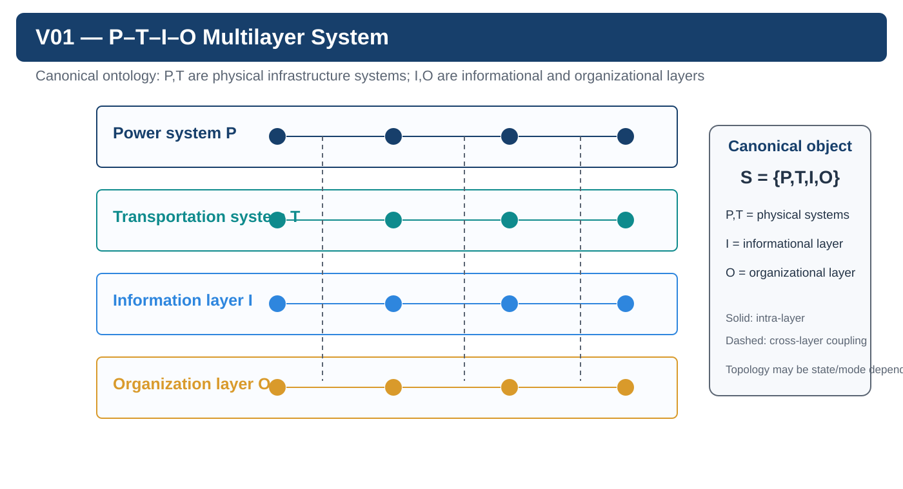

# Canonical System Definition


**Adopted:** 2026-09-11  
**Degree:** Master of Science in Engineering (MSE), Sustainable Engineering  
**Scope:** Multilayer interdependent infrastructure resilience and sustainable transformation  
**Change rule:** Use this system description throughout the thesis unless it is explicitly revised and versioned.

> **Degree nomenclature:** This research is an **MSE (Master of Science in Engineering)** thesis.

---

## 1. Canonical system class

The thesis studies a **multilayer interdependent infrastructure system** with

```math
P,T=\text{physical infrastructure systems},
\qquad
I,O=\text{informational and organizational layers}.
```

The most precise description is:

> **A multilayer physical–informational–organizational interdependent Power–Transportation infrastructure system.**

The canonical system object is

```math
\mathcal S=\{P,T,I,O\}.
```

When a layer-index set is needed, use

```math
\mathcal L=\{P,T,I,O\}.
```

$\mathcal S$ denotes the system object; $\mathcal L$ denotes the layer/system index set. These roles must not be silently interchanged.

---

<!-- CANONICAL_VISUAL:V01 -->

### V01 — P–T–I–O Multilayer System

<p align="center">
  
</p>

> **Visual synopsis:** This figure compresses the scientific architecture for navigation and interpretation. The equations, definitions, evidence status, and boundary rules in the owning document remain authoritative.

<!-- /CANONICAL_VISUAL:V01 -->

## 2. Layer interpretation

| Symbol | Type | Principal role |
|---|---|---|
| $P$ | Physical infrastructure system | generation, transmission, distribution, DER/storage, charging and traction-power supply |
| $T$ | Physical infrastructure system | road, electric bus, urban rail, heavy/regional rail and multimodal transportation |
| $I$ | Informational layer | sensing, communication, data availability/quality, latency, synchronization, estimation support and signaling |
| $O$ | Organizational layer | authority, coordination, decision making, resources, workforce, logistics, mobilization and intervention capability |

The physical state is

```math
X(t)=
\begin{bmatrix}
x_P(t)\\
x_T(t)
\end{bmatrix}.
```

The informational–organizational state is

```math
Z(t)=
\begin{bmatrix}
z_I(t)\\
z_O(t)
\end{bmatrix}.
```

The integrated state is

```math
Y(t)=
\begin{bmatrix}
x_P(t)\\
x_T(t)\\
z_I(t)\\
z_O(t)
\end{bmatrix}.
```

$I$ and $O$ name layers/functions; $z_I(t)$ and $z_O(t)$ are their time-varying states.

---

## 3. Modeling discipline

The thesis must not reduce the system to a purely physical P–T network when information or organization materially affects observation, coordination, control, propagation, recovery, viability or transformation.

Accordingly,

```math
R_{\rm system}\neq R(P,T)
```

in the general case studied here. The conceptual dependence is

```math
R_{\rm system}
=
R(P,T,I,O,\mathbb I),
```

where $\mathbb I$ denotes the set of explicitly characterized interdependency objects.

The canonical Stage-2 interdependency object is

```math
\mathfrak I_{ij}^{\alpha\beta}
=
\left(
E_i^\alpha,
E_j^\beta,
M_{ij},
w_{ij},
\delta_{ij},
\tau_{ij},
a_{ij},
m,
\mathcal H_t
\right),
```

with

```math
\alpha,\beta\in\{P,T,I,O\},
\qquad
\alpha\neq\beta.
```

---

## 4. Canonical cross-stage interpretation

| Stage | Use of the system definition |
|---|---|
| **1 — Multilayer Structure** | define what exists and where interaction can occur |
| **2 — Causal Mechanisms** | determine which cross-layer relations are causal and how effects are transmitted |
| **3 — Coupled Hybrid Multiscale Dynamics** | evolve $Y(t)$, modes and effective topology across heterogeneous timescales |
| **4 — Observation, Organization, Feedback and Control** | measure/infer the physical state and map informational/organizational capability into feasible $u(t)$ |
| **5 — Viability** | determine whether controlled trajectories remain acceptable and maintainable |
| **6 — Resilience-to-Sustainability Transformation Interface** | determine whether preserving the current regime remains adequate and specify required change |
| **7 — Sustainable Transformation Pathways** | transform candidate regimes and compare adaptive pathways under feasibility and uncertainty |

---

## 5. Action hierarchy

Operational control and strategic transformation are different objects:

```math
\underbrace{u(t)}_{\text{operate the current regime}}
\neq
\underbrace{\mathbf a_k}_{\text{transform the regime}}.
```

The strategic action $\mathbf a_k$ is also distinct from the Stage-2 interdependency activation $a_{ij}$.

The Stage-7 regime object is

```math
\mathfrak M_k
=
(\mathcal S_k,\mathcal G_k,\mathfrak I_k,F_k,\Theta_k,K_{{\rm sus},k},\mathcal U_k).
```

Thus the original system ontology remains fixed while Stage 7 may change the architecture/configuration of a candidate future regime.

---

## 6. Canonical thesis statement

> **The research studies a multilayer interdependent Power–Transportation infrastructure system in which Power and Transportation form the physical infrastructure systems, while Information and Organization form interacting informational and organizational layers that shape observation, coordination, control, propagation, recovery, viability, regime adequacy and sustainable transformation.**

This is the default system identity for thesis chapters, figures, literature extraction, mathematical models, simulation, validation and transformation-pathway analysis unless changed through an explicit versioned revision.
