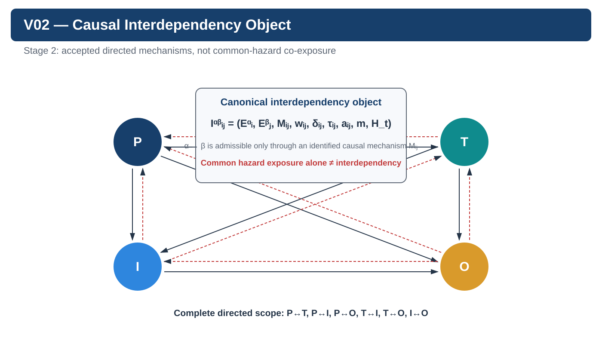

# Stage 2 — Interdependency Mechanisms


**Framework stage:** Stage 2 — Causal Mechanisms  
**Status:** CANONICAL / FROZEN  
**Frozen:** 2026-09-11  
**Degree:** Master of Science in Engineering (MSE), Sustainable Engineering  
**Change rule:** Do not revise this Stage-2 scientific scope unless explicitly requested and versioned.  
**Framework preservation rule:** This file formalizes Stage 2 only and does not alter the seven-stage framework.

> **Rendering rule:** Use GitHub display mathematics for equations, tables for taxonomies, and short prose outside mathematical boxes.

---

## 1. Stage role

Stage 1 defines the system ontology

```math
\{P,T,I,O\}.
```

Stage 2 defines how those systems/layers **causally affect one another**. The progression is

```math
\{P,T,I,O\}
\longrightarrow
\mathfrak I_{ij}^{\alpha\beta}.
```

Stage 2 answers:

> **Why and through what mechanism does one component or layer affect another?**

---

<!-- CANONICAL_VISUAL:V02 -->

### V02 — Causal Interdependency Object

<p align="center">
  
</p>

> **Visual synopsis:** This figure compresses the scientific architecture for navigation and interpretation. The equations, definitions, evidence status, and boundary rules in the owning document remain authoritative.

<!-- /CANONICAL_VISUAL:V02 -->

## 2. Complete directed interdependency scope

The complete directed set is

```math
\begin{aligned}
\mathcal I=\{&P\to T,\ T\to P,\ P\to I,\ I\to P,\ P\to O,\ O\to P,\\
&T\to I,\ I\to T,\ T\to O,\ O\to T,\ I\to O,\ O\to I\}.
\end{aligned}
```

Equivalently, Stage 2 contains six bidirectional families:

```math
\begin{aligned}
&P\leftrightarrow T,
\qquad P\leftrightarrow I,
\qquad P\leftrightarrow O,\\
&T\leftrightarrow I,
\qquad T\leftrightarrow O,
\qquad I\leftrightarrow O.
\end{aligned}
```

This scope is broader than a single physical Power–Transportation interface.

---

## 3. Interdependency families and measurable effects

| Direction | Interdependencies in scope | Main measurable effect |
|---|---|---|
| $P\rightarrow T$ | EV/eBus charging, traffic signals, station power, metro/MRT/LRT traction power, railway traction power | mobility capacity, train operation, charging availability |
| $T\rightarrow P$ | repair-crew accessibility, equipment logistics, EV/V2G, regenerative braking, transport-dependent restoration | repair time, power restoration, grid injection/load |
| $P\rightarrow I$ | electricity supply to sensors, communication equipment, control centres, SCADA/ITS/rail control | information availability |
| $I\rightarrow P$ | measurements, SCADA, state estimation, protection information, DER/charging/traction control | observability, control accuracy, response delay |
| $P\rightarrow O$ | outage severity, damaged assets, critical-service loss, restoration requirements | organizational workload and resource demand |
| $O\rightarrow P$ | switching, repair sequencing, crew allocation, DER dispatch, load restoration | power-state and recovery trajectory |
| $T\rightarrow I$ | traffic states, accessibility, EV SOC, bus telemetry, train position/speed, service status | transport situational awareness |
| $I\rightarrow T$ | V2X, traffic control, routing, fleet control, CBTC, ATP, ATO, ATS | mobility operation and safety |
| $T\rightarrow O$ | congestion, blocked roads, inaccessible assets, rail disruption, logistics constraints | feasible response actions |
| $O\rightarrow T$ | road management, rerouting, dispatch, rail scheduling, emergency routing | transport-state/recovery trajectory |
| $I\rightarrow O$ | estimated state, alarms, forecasts, damage information, confidence, information freshness | decision quality and decision time |
| $O\rightarrow I$ | monitoring priorities, reporting rules, information sharing, communication priorities, access authority | information availability and flow |

---

## 4. Subsystem-level decomposition

For each directed family, the interdependency set is decomposed to the component/subsystem level. For example,

```math
\mathcal I^{P\rightarrow T}
=
\bigcup_{p\in P}
\bigcup_{t\in T}
\mathcal I_{pt}^{P\rightarrow T}.
```

An edge is retained only when a real causal mechanism exists.

| Example chain | Interpretation |
|---|---|
| $P_D\rightarrow P_C\rightarrow T_R$ | EV charging |
| $P_D\rightarrow P_C\rightarrow T_B$ | electric-bus charging |
| $P_{Tr/D}\rightarrow P_{TP}\rightarrow T_U$ | urban-rail traction |
| $P_{Tr}\rightarrow P_{TP}\rightarrow T_H$ | heavy/intercity rail traction |
| $T_R\rightarrow O_L\rightarrow P_D$ | road accessibility affecting power repair |

The same component-level decomposition is developed for all 12 directed relationships when evidence supports a causal pathway.

---

## 5. Canonical interdependency object

Every accepted interdependency is represented by

```math
\mathfrak I_{ij}^{\alpha\beta}
=
\left(
E_i^\alpha,
E_j^\beta,
M_{ij},
w_{ij},
\delta_{ij},
\tau_{ij},
a_{ij},
m,
\mathcal H_t
\right),
```

with

```math
\alpha,\beta\in\{P,T,I,O\},
\qquad
\alpha\neq\beta.
```

| Element | Meaning |
|---|---|
| $E_i^\alpha$ | source entity/component |
| $E_j^\beta$ | receiving entity/component |
| $M_{ij}$ | causal transmission mechanism |
| $w_{ij}$ | interdependency strength |
| $\delta_{ij}$ | cause-to-effect delay |
| $\tau_{ij}$ | characteristic mechanism timescale |
| $a_{ij}$ | activation state/condition |
| $m$ | system operating mode |
| $\mathcal H_t$ | relevant history/path dependence |

The minimum accepted causal representation is

```math
\text{Source}
\rightarrow
\text{Mechanism}
\rightarrow
\text{Receiver}
\rightarrow
\text{Effect}.
```

An arrow alone is therefore insufficient.

---

## 6. Delay and timescale are different

The Stage-2 timing discipline is

```math
\delta_{ij}\neq\tau_{ij}.
```

Here $\delta_{ij}$ is the lag between cause and the arrival/observation of its effect, whereas $\tau_{ij}$ characterizes the rate or duration over which the mechanism evolves.

This distinction is preserved in Stage 3 and must not be collapsed into one generic “time” parameter.

---

## 7. Causal admissibility rule

Correlation, co-occurrence, co-location, or common hazard exposure does **not** establish an interdependency.

For example,

```math
h(\mathbf r,t)\rightarrow P_i,
\qquad
h(\mathbf r,t)\rightarrow T_j
```

does not imply

```math
P_i\rightarrow T_j.
```

A retained cross-system relation requires

```math
P_i\xrightarrow{M_{ij}}T_j,
```

or, in general,

```math
\alpha\xrightarrow{M_{ij}}\beta.
```

This is the canonical causal-admissibility rule.

---

## 8. Position inside the seven-stage framework

The cross-stage interface is

```math
\begin{aligned}
\{P,T,I,O\}
&\rightarrow \mathfrak I_{ij}^{\alpha\beta}
\rightarrow \{Y,\mathcal G,m,T_C\}\\
&\rightarrow \{\widehat X,\mathcal U,u,\tau_{\rm response}\}
\rightarrow \{K_{\rm sus},\mathcal V,\partial\mathcal V,\rho,T_{\mathcal V},T_K\}.
\end{aligned}
```

Stage 2 has a bounded responsibility:

> **Identify, classify, parameterize, and evidence causal interdependencies among $P$, $T$, $I$, and $O$; do not yet solve their full coupled dynamics.**

---

## 9. Evidence companion

Literature grounding and APA 7 references for this stage are maintained in [`STAGES_1_2_APA7_EVIDENCE_GROUNDED.md`](STAGES_1_2_APA7_EVIDENCE_GROUNDED.md).

The complete tuple $\mathfrak I_{ij}^{\alpha\beta}$ is a thesis synthesis; it must not be attributed to one paper unless a source explicitly defines the same object.

---

## 10. Freeze statement

Stage 2 remains **canonical and frozen**. Future Stage-2 diagrams, evidence tables, subsystem matrices, equations, simulations, and thesis text must remain consistent with this specification unless an explicit versioned revision is approved.
